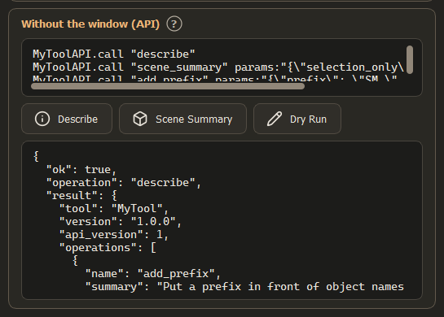

# The tool without its window: the API

Every tool made with this skill has an API by default: the same operations its window offers, callable from
MAXScript, from Python and by AI assistants through Max Ultra MCP, with no window open. Build it with the tool, not
afterwards: the window is one caller of the API, scripts and assistants are others.

## The parts

| File | What it does |
| --- | --- |
| `python/mytool/max_api.py` | The scene work, on Max's main thread only; pymxs lives here and nowhere else. Plain values in, plain data out (handles, names, counts); a change takes `dry_run` and runs in one undo record. |
| `python/mytool/api.py` | The public operations: a table of name, function, summary, `changes_scene`, parameters (type, required, default, choices, limits, pattern, text) and an example; `describe`, `call`, `call_json`, `call_from_maxscript`. |
| `python/api_entry.py` | Loads the package without the window: the same copy the window starts (`bootstrap.pick_root`), or the window's own modules when it is open. Imports `bootstrap.py` with `_MYTOOL_IMPORT_ONLY` so it does not start a window. |
| `MyToolAPI.ms` | Defines the MAXScript global `MyToolAPI` with `call operation params:"{...}"`. `StartMyTool.ms` runs it first; a startup script may run it alone so the API is there from Max's start. Nothing loads until the first call. |

The starter's operations are examples to replace: `describe`, `scene_summary` (read-only), `add_prefix` (changes
names, with `dry_run`), `get_settings` and `set_setting` (the settings an assistant may touch, listed in
`PUBLIC_SETTINGS`; a theme change shows at once in an open window).

## Rules

- **One code path.** The window's buttons call the same functions (`api.call` or `max_api` directly); never a second
  copy of the logic for the API. A fix reaches both.
- **An envelope, never an exception.** `{"ok": true, "operation": ..., "result": ..., "warnings": [...]}` or
  `{"ok": false, "operation": ..., "error": {"code": ..., "message": ...}}`. Codes: `UNKNOWN_OPERATION`,
  `INVALID_PARAMS`, `INVALID_JSON`, `NOT_IN_MAX`, `FAILED`. The message says what to do ("prefix is required
  (letters, digits, - and _)"); the log keeps the traceback.
- **Described.** `describe` returns the tool, its version, `API_VERSION` and every operation with its parameters and
  an example, so an assistant reads it first and calls only what it lists. Write each `summary` and parameter `text`
  for a reader who has not seen the window.
- **Checked at the boundary.** Types, required parameters, choices, limits and patterns are checked before the
  function runs; an unknown parameter is refused, never ignored. MAXScript literals are never built from raw text.
- **Safe changes.** A call that changes the scene says so (`changes_scene`), takes `dry_run` (try it first), runs
  inside one undo record (`pymxs.undo(True, "...")`), and returns what it changed: handles, old and new names,
  counts. It works on NodeRefs by handle, never by name alone.
- **No interface.** No dialogs, prompts, message boxes or file pickers in an API call; a missing answer is an
  `INVALID_PARAMS` error. Paths come as parameters.
- **Main thread.** Scene work runs on the main thread (MAXScript, Max Ultra MCP's `max_execute` and the window all
  call it there). A long operation runs as a job in the window; through the API it returns a short result, or is
  split into steps the caller repeats.
- **Stable.** `API_VERSION` grows only when an existing call changes meaning; adding an operation does not change
  it. Keep old names working.
- **Logged.** Each call writes one line to the tool's log (`mytool.api`: operation and result code).

## Calling it

```maxscript
MyToolAPI.call "describe"
MyToolAPI.call "scene_summary" params:"{\"selection_only\": true}"
MyToolAPI.call "add_prefix" params:"{\"prefix\": \"SM_\", \"dry_run\": true}"
```

```python
from mytool import api
api.call("add_prefix", prefix="SM_", dry_run=True)
```

An assistant with Max Ultra MCP runs the MAXScript lines through `max_execute` (or the Python through
`python.Execute`), reads the JSON, and shows the user what a `dry_run` would change before it runs the real call.

## In the trainer

The Windows section's panel "Without the window (API)" shows the calls and three buttons (Describe, Scene Summary, a
dry run of Add Prefix) that call the same API and print its JSON answer.



## Checks

The trainer's checks call `describe`, refuse an unknown operation, a missing parameter, an unknown parameter and a
wrong value, read the scene, try `add_prefix` only with `dry_run`, read JSON in and out, call `MyToolAPI.call`
through MAXScript (and put the owner's `MyToolAPI` back), load `api_entry.py` without a new window session, and
press the panel's button. They never change settings or the scene through the API.

MaxPkg: `MyToolAPI.ms`, `python/api_entry.py`, `python/mytool/api.py` and `python/mytool/max_api.py` are runtime
files; add them to the packager's explicit file list ([MaxPkg delivery](maxpkg-delivery.md)).
