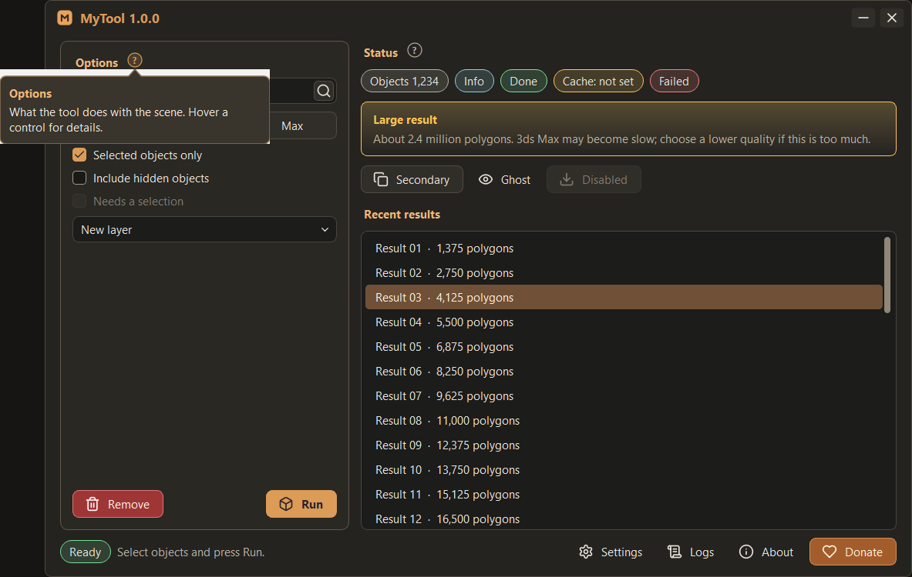
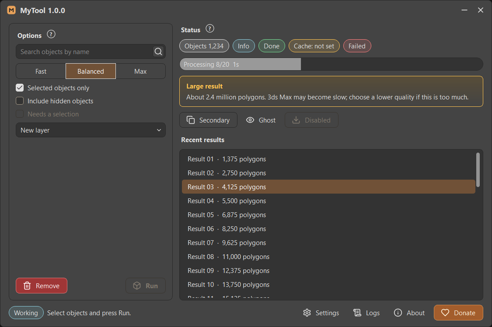

# Controls catalog

How every shared control looks and behaves in tools made with this skill. Implementations: [controls](templates/controls.md)
and [style sheet](templates/themes-style.md). Sizes are logical pixels at 100 % interface size (`px()` scales them, the
style sheet is scaled as a whole). Colours are palette roles (`@role` in QSS); never a literal colour in a widget.



## Typography and text

| Element | Look |
| --- | --- |
| Window font | The application font times the interface size (set once per top-level window, `scale_font`) |
| Window title (`toolWindowTitle`) | Accent colour, bold, 10 pt |
| Section title (`toolSection`) | `heading_text`, bold, 4 px top padding; followed by a "?" help button |
| Group title (`toolGroupTitle`) | `heading_text`, bold, 10 pt (Settings groups) |
| Muted text (`toolMuted`) | `muted_text`; status messages, notes, metadata labels |
| Caption (`toolCaption`) | `muted_text`, 8 pt |
| Error text (`toolError`) | `log_error` |
| Links | `support_link` colour, no underline in About; links open in the browser |

Captions use Title Case for buttons ("Copy Diagnostics", "Reopen Now") with short words lower case. Never put a bare
`&` in widget text: Qt takes it as a mnemonic (write "and", "+" or `&&`).

## Buttons

`controls.Button(text, theme, icon=..., variant=..., tooltip=...)`; one class for all.

| Variant | Look | Use |
| --- | --- | --- |
| `secondary` (default) | `surface` fill, 1 px `border`, radius 6, padding 5 / 12, min height 18 | Ordinary actions |
| `primary` | `accent` fill, `log_badge_text` text, bold; hover `focus` | The one main action of a panel (Run, Build) |
| `danger` | `delete_background`, `delete_text`, `delete_border`; hover / pressed darker | Remove, delete |
| `ghost` | Transparent, no border; hover shows `hover` fill and `border` | Status bar and toolbar actions |
| `donate` | `donate_background`, `status_button_text`, `donate_border`; hover `donate_hover` | Donate only |

- States: hover `hover` + `active_border`, pressed `pressed`, focus `focus` border, checked `selected` + accent border,
  disabled `disabled_surface` / `disabled_text` / `disabled_border` without hover.
- Icon: original Lucide SVG, 16 px, tinted with the variant's text colour (disabled: `disabled_text`), rendered at the
  device pixel ratio. An en space separates icon and text.
- Cursor: pointing hand only while enabled (updated on enable changes).
- Square icon buttons (`toolIconButton`): 26 x 26, padding 2, radius 4, transparent border until hover. Icon-only
  buttons always have a tooltip and an accessible name.
- A button inside a field (`toolFieldButton`): the field's height minus 6, 3 px from its right end, `surface` fill and
  `border`; the field gets a right text margin so text never runs under it.
- The primary action of a panel is pinned at the bottom of the panel, outside any scroll area.

## Segmented choice

`controls.Segmented(((key, label, tooltip), ...), theme, current)`: an exclusive row of checkable buttons (Fast /
Balanced / Max, All / Warnings / Errors). Buttons are placed by hand, each overlapping its left neighbour by 1 px, so
borders never double; the checked one is raised so its accent border shows on every side. First / middle / last
segments square their inner corners. A negative layout spacing is *not* an overlap in Qt (it means "style default").
The minimum width is the text widths plus a small margin, so the row fits narrow panels.

## Status pills

`controls.Pill(theme, text, variant)`: a capsule painted once (height = font height + 8, horizontal padding 10, radius =
half the height). Border in the tone colour, fill the same tone at alpha 40, text `text`. Tones: `neutral` ->
`muted_text`, `info` -> `log_info`, `success` -> `log_success`, `warning` -> `log_warning`, `error` -> `log_error`.
Long text elides in the middle; the full text is the tooltip and the accessible name. Minimum width 64, so a pill never
widens its column. `set_clickable(True)` makes it a button (pointing hand, `clicked`). Keep numbers in short labels
("Objects 1,234").

## Progress



`controls.ProgressBar`: a pill track in `recessed` with a 1 px `border`, fill `accent` at alpha 150 clipped to the
rounded track. Known work: real `done / total`; unknown work: a sweep 30 % wide moving every 40 ms, never invented
percentages. Caption inside: `Label done/total  12s` with elapsed seconds from `time.monotonic()`. The timer runs only
while visible and busy. Results and errors come back as text in the status bar and a pill.

## Fields, dropdowns, checkboxes, lists

- **Fields** (`QLineEdit`, text edits): `field` fill, `field_text`, 1 px `field_border`, radius 6, padding 4 / 6,
  selection `selected` / `selected_text`; focus border `focus`; read-only `recessed`; disabled `disabled_text`.
- **Dropdowns** (`controls.ComboBox`): field look, 26 px right padding, Lucide `chevron-down` 12 px tinted (QSS needs
  icon files: the theme manager writes tinted copies per theme). The popup is a `QListView` (`toolPopup`): `popup`
  fill, padding 4, rows radius 4 with min height 20, hover and selection `selected`. It opens 4 px below the field, or
  above when there is no room, clamped to the screen's work area.
- **Checkboxes**: 13 px indicator, radius 3, `recessed` fill, `checkbox_border`, hover `checkbox_hover_border`; checked:
  `accent` fill with a tinted Lucide `check`; partly checked: `minus`; disabled checked and unchecked states have their
  own icons and colours. Spacing 7 px to the text; pointing-hand cursor while enabled.
- **Completer lists** (search suggestions): the list continues its field: the field squares its bottom corners while the
  list is open (`open="true"`), the list has the `focus` border without a top border and rounded bottom corners, and
  its rows start exactly where the field's text starts (`SuggestionDelegate`, set after `setPopup`, which replaces
  delegates). Register the popup with the theme manager.
- **Lists** (`QListWidget`): field look with padding 4; rows padding 4 / 8, radius 4, hover `hover`, selection
  `selected` / `selected_text`, no focus rectangle. **Tables** (`toolTable`): alternate rows `surface`, header
  `surface` with `muted_text` and a bottom `border`.

## Scroll bars

Thin, no visible track, a pill thumb rounded over its whole width (see the list in the main window picture):

```css
QScrollBar:vertical { width: 10px; background: transparent; border: none; margin: 0px; }
QScrollBar::handle:vertical { background: @scroll_thumb; min-height: 28px; border-radius: 3px; margin: 2px; }
QScrollBar::handle:hover { background: @scroll_hover; }
QScrollBar::handle:pressed { background: @scroll_pressed; }
```

The thumb is 6 px (10 - 2 x 2) and its radius exactly half of it. Keep that ratio when changing sizes: every px in the
style sheet is scaled and rounded on its own, and Qt draws a **square** thumb when the radius exceeds half the thumb
(a 8 px bar with a 3 px radius became 7 px wide with a 4 px radius at 125 % and lost its rounding). Clear arrows,
add-line / sub-line and add-page / sub-page; make `QAbstractScrollArea::corner` and scroll-area backings transparent.
Check the thumb in a zoomed screenshot at 100 %, 125 %, 150 % and 200 %.

## Help balloons

A small round "?" (`controls.HelpButton`, 16 px circle, `muted_text` outline; `accent` outline and a faint accent fill
on hover or while open, bold "?") beside a section title. A click opens a `Balloon`: 280 px wide, padding 10, radius 6,
an arrow of 7 px pointing at the button, `tooltip_background` fill, `active_border` outline, bold title in
`heading_text` and a short description in `tooltip_text`. It opens below the button when it fits on the screen, else
above, and stays inside the work area. A second click on "?", a click elsewhere or Esc closes it. Shaped by a window
mask (no translucent popups inside Max).

## Panels, groups, warnings, tabs

- **Panel** (`toolPanel`): `tab_pane_background`, 1 px `group_border`, radius 8; inner margins 12 / 10 / 12 / 12,
  spacing 8. A section block inside (`toolPanelSection`): `surface`, `border`, radius 6.
- **Settings group** (`toolSettingsGroup`): `active_tab_background`, `group_border`, radius 6, margins 12 / 8 / 12 / 10,
  a group title, then a form (12 px between label and field, 6 px between rows, labels left).
- **Warning block** (`toolBanner`): a gradient from `log_warning_background` to transparent, 1 px `log_warning`
  border, radius 6, a bold title in `log_warning` and muted text. **Danger block** (`toolDanger`) the same in the error
  colours. Use them for large-result warnings, disclaimers and short-of-disk messages.
- **Tabs**: tabs radius 6 at the top, padding 6 / 18, 2 px apart; the selected tab has the pane's colour and joins the
  pane, whose top-left corner is square under the first tab.
- **Tooltips**: `tooltip_background`, `tooltip_text`, `border`, padding 4 / 6. **Menus**: `popup` fill, padding 4, items
  radius 4, `selected` highlight, 1 px separators, danger actions in the error colour after a separator.

## Small behaviours

- **Copy feedback**: the button shows "Copied" for 2000 ms (one restartable single-shot timer), then its caption again.
- **ElidedLabel**: one line that elides in the middle instead of widening the layout; full text in the tooltip.
- **Marquee**: one line that scrolls right to left in a loop when it does not fit, pausing 1.5 s each time round.
- **Shimmer**: a soft light band sweeping over a button every few seconds to draw the eye to one action (use sparingly).
- **FlowLayout**: chips that wrap to new rows.
- Timers of animated controls run only while they are visible.

## Lucide icons by action

| Action | Icon | Action | Icon |
| --- | --- | --- | --- |
| Collapse to bar | `minus` | Close | `x` |
| Drag handle | `grip-vertical` | Settings | `settings` |
| Logs | `scroll-text` | About | `info` |
| Donate | `heart` | Refresh, reopen | `refresh-cw` |
| Copy | `copy` | Open folder | `folder-open` |
| Move to folder | `folder-input` | Search | `search` |
| Delete, remove | `trash-2` | Clear, erase | `eraser` |
| Show / hide | `eye` / `eye-off` | Layers | `layers` |
| Bookmark / save | `bookmark` / `bookmark-plus` | Download | `download` |
| Disk, cache | `hard-drive` | Back | `arrow-left` |
| Run, build | `box` | Stop | `circle-stop` |
| Success | `circle-check` | Error, warning | `circle-alert` |
| Rectangle tool | `square-dashed` | Polygon tool | `pentagon` |
| Locate | `crosshair` / `map-pin` | Link | `link` |
| Edit | `pencil` | Quit | `log-out` |
| Checkbox tick | `check` | Dropdown arrow | `chevron-down` / `chevron-up` |

Use the original Lucide SVG files (`stroke="currentColor"`, replaced by the role colour when rendering), with the ISC
license in the tool. No emoji, font symbols or redrawn paths.
