# Controls catalog

How every shared control looks and behaves in tools made with this skill, and when to use it. Implementations:
[controls and toasts](templates/controls.md), [forms, switches and pickers](templates/forms.md),
[logs and the mini log](templates/logs.md), [dialogs and questions](templates/dialogs.md),
[sections and inputs](templates/sections-inputs.md), [sliders, colours and badges](templates/sliders-colors-badges.md),
[cards and area states](templates/cards-states.md), [dropdowns, choice cards, tree and drop zone](templates/combos-tree.md),
[charts and loading](templates/charts-loading.md) and [style sheet](templates/themes-style.md). The
[main window example](templates/main-window-example.md) is a controls trainer that shows all of them in one design, in
eleven sections chosen from a list on the left: it is a gallery to see them work together, not a layout to copy. Sizes are logical pixels at 100 % interface size (`px()` scales them, the style sheet
is scaled as a whole). Colours are palette roles (`@role` in QSS); never a literal colour in a widget (the one
exception: the close button's red hover, the same in every theme).

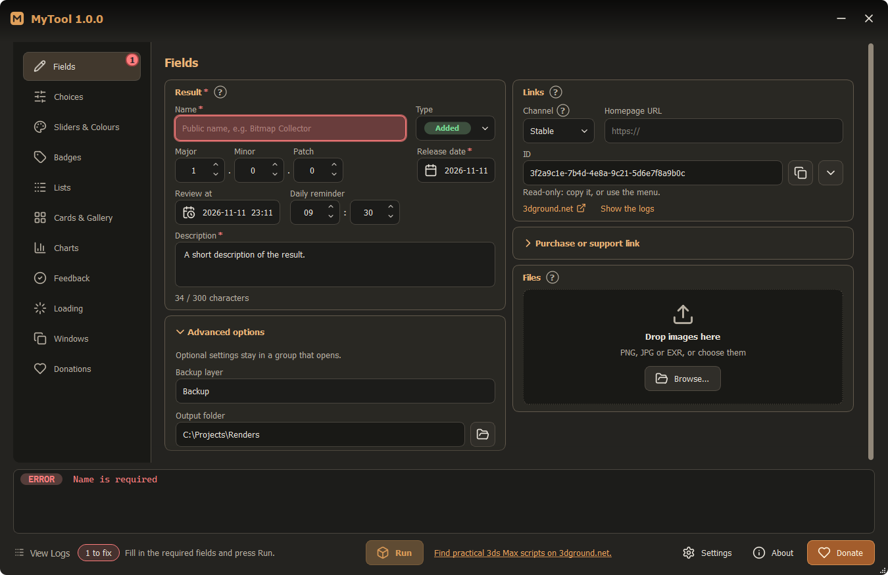

## Rules that hold for every control

- **One height.** Every single-line control is 30 px high (`controls.CONTROL_HEIGHT`): fields, dropdowns, buttons,
  steppers, the date field. `controls.unify_heights(window)` sets it after a window or dialog is built and again in its
  `showEvent` (style-sheet sizes apply at first show); a button without text becomes a 30 x 30 square. A button is never
  taller or shorter than the field beside it. Parts with their own size are listed in `controls._OWN_SIZE` (menu
  items, calendar days, stepper arrows, round window buttons, buttons inside fields).
- **Rounded.** Fields, dropdowns, buttons, lists, text boxes, menus, popups and panels all have rounded corners; a popup
  window is rounded by a window mask (`controls.round_popup`), never by a translucent window inside Max.
- **A coloured control never turns grey.** A disabled primary or danger button keeps a darker shade of its own colour
  with text and icon in a lighter shade of it (`themes.derived`: `accent_disabled*`, `danger_disabled*`). Only neutral
  controls (secondary, ghost, fields) use the disabled greys.
- **Scrolling never changes a field.** The mouse wheel over a dropdown or a stepper does not change its value, focused
  or not: it scrolls the page under it. A dropdown's value is chosen in its open list or with the keyboard, a stepper's
  with its arrows or the Up / Down keys. Only an open popup uses the wheel for itself (the calendar turns its month).
- **Compact and narrow.** A tool's window is one column about as wide as the Command Panel (300-360 px at 100 %)
  unless its content needs width (a table, a gallery, logs); panels use the small insets below; windows open at a
  sensible size and are resized only by the user.
  Showing or hiding a part (the mini log, a group) takes room from the page, which scrolls if it must.
- **An outlined popup is outlined on every side, the arrow included.** A popup shaped by a window mask (balloon,
  error bubble, anything with an arrow) paints its outline with `controls.paint_bubble`: never a stroke centred on the
  edge (half of it falls outside the mask and the widget's right and bottom edges, and the bubble looks open there).
- **Bubbles cast a light shadow.** The red error bubble and the help balloon have Windows' own small popup shadow
  (`CS_DROPSHADOW`, the one Qt's tooltips have): soft, about 3-4 px right and below, following the window mask with
  its rounded corners and arrow. No translucent window paints it. The balloon is a `Qt.Popup` without
  `NoDropShadowWindowHint`; the bubble is a `Qt.ToolTip` whose class inherits an empty base named `QTipLabel` (Qt for
  Windows gives the shadow to tooltip windows only through that class name). The colour picker casts it too (a
  `Qt.Popup` without the hint). It follows the Windows setting "Show shadows under windows". Menus, dropdown lists and
  the calendar keep `NoDropShadowWindowHint`.
- **One chrome for every window.** Settings, About, Logs, questions and small edit windows have the main window's own
  title bar (icon, title, round close button), header shade and rounded corners (`dialogs.ToolDialog`). No native
  Windows title bar and no `QMessageBox` anywhere in a tool; questions use `dialogs.ask`.
- **Every message is the tool's own.** Questions (`dialogs.ask`), information, warnings and errors (`dialogs.inform`),
  one-line prompts (`dialogs.ask_text`), the welcome window and the donation request are tool windows; never
  `QMessageBox`, `QInputDialog`, `QErrorMessage` or `QProgressDialog`. Only the system's file and folder pickers stay
  native.
- **One size in a dialog's bottom row.** The buttons of a footer (Donate and Close, Cancel and OK, Not now and Donate,
  Open Settings and Get Started) share one width, the widest one's and at least 92 px (`controls.same_width`, applied
  by `unify_heights`), and one height. A short "Close" beside an icon button otherwise looks smaller although both are
  30 px high. A single footer button still gets the 92 px.
- **Soft edges where content is cut.** A scrolling page or list fades into its background at a clipped top or bottom
  edge (`controls.EdgeFade`, `fade_edges`), as in the MaxPkg Package Manager: the top edge once scrolled, the bottom
  edge while more is below.
- **No dotted focus frame.** A focused button shows the `focus` border colour only (`outline: none`).
- **On the spacing scale.** Every margin, gap and padding is a step of one scale, as in any design system's space
  tokens: **0, 2, 4, 6, 8, 12, 16, 20, 24, 32, 40, 48** px at 100 % (`ui_scale.SPACE`). Layout code asks for a step
  with `ui_scale.space(n)`, which refuses any other value (`space(10)` raises `ValueError`); style sheet paddings and
  margins use the same steps. Never an in-between value (3, 5, 10, 11, 14, 18). What each step is for: 2 lines that
  belong together, stacked navigation buttons; 4 an icon and its counter, tight pairs, a field's caption and the field;
  6 a panel's title and its content, chips, a caption and its hint; 8 controls in one row, a popup's inner margin, a
  footer's buttons; 12 fields side by side, a panel's inner margin, panels in a column; 16 a dialog's or a page's
  margin, groups on a page; 20 and 24 an empty state or a welcome window; 32 to 48 hero areas. The few raw sizes that
  are not spacing (a field frame's 1 px border inset, the free resize edges, the packager's collapsed bar) say so in a
  `# Not spacing:` comment; the trainer's checks read every layout call and the style sheet and fail on anything else.
- **Nothing jumps.** What replaces a part takes the part's own room: a list's empty state stands in the list's place
  (`states.StateArea`), so the search field above it never moves while the user types; skeleton rows hold the place of
  content that is on its way; a busy button keeps its size.

## Choosing controls

Build the smallest interface that does the job. The catalog is a toolbox, not a checklist: a tool takes the controls
its task needs, and every mark (a red star, a "?", a group, a pill) must carry information the user would otherwise
miss. Decide per element:

| The user needs to... | Use | Not |
| --- | --- | --- |
| Turn one setting on or off, effective at once | Switch | A check box, a two-item dropdown |
| Pick several items of a list (objects, layers, file types), or see a partly selected group | Check boxes (tri-state for a group), toggle chips for short names | Switches |
| Choose one of 2-4 short options that are worth seeing side by side | Segmented choice | A dropdown |
| Choose one of many options, or options with long names | Dropdown | Segments that do not fit |
| Choose among items of different kinds (a scene file, an image, a report) | Dropdown with an icon per item | A plain list of names |
| Choose from a long list that falls into groups | Dropdown with group headings | One long flat list |
| Pick a known value or type a new one (a layer name) | Editable dropdown | A field and a dropdown side by side |
| Choose several values that combine, where room is short (object kinds to export) | Dropdown with check boxes ("Geometry, Materials", "3 selected") | A row of check boxes that does not fit |
| Choose one of 2-4 options whose difference needs a sentence (quality, export mode) | Choice cards: icon, title, a line of text | Segments with cryptic short words |
| Browse layers with their objects and tick parts of them | Scene tree with check boxes | A flat list that loses the layers |
| Bring files in (pictures, references) | Drop zone with Browse | A path field alone |
| Narrow a list by a category, with how many each holds | Filter pills (coloured, with counts) | Tabs, a dropdown hidden in a corner |
| Filter by a value that is usually "any" | Clearable dropdown (an x while a filter is on) | A dropdown without a way back |
| Set an amount within limits, where the feel matters more than the digit (opacity, strength) | Slider | A free text field |
| Set a range (polygons between, distance from-to) | Two-handle slider | Two unrelated fields |
| Choose a colour | Colour field with its picker (presets, recent, hex) | Three number fields, the system colour dialog |
| Find an item in a long list | Search field with suggestions, an empty state when nothing matches | Scrolling alone |
| Keep a short list of values (extensions, names, tags) | List editor (add, paste many, edit, reorder) or removable tags | A comma-separated text field |
| Browse items with a picture or a description (presets, scenes) | Cards in a responsive grid | A plain list of names |
| Look at several pictures | Gallery: a large picture and thumbnails | Separate windows per picture |
| Choose a category that also appears as a badge in a list | Badge dropdown | A plain dropdown |
| Enter a whole number in a small range (a version part, a count) | Stepper | A free text field |
| Enter a date | Date field with its calendar (months and years one click away) | A text field, a native date edit |
| Enter a date and a time | Date field with a time (`with_time=True`, Done applies both) | Two unrelated fields |
| Enter a time of day | Time field (hours and minutes that wrap) | A free text field |
| Enter a path | Read-only field and a folder or file button | A free text field alone |
| See where a value must be filled in | Red star, only on fields the validation actually requires | Stars on optional fields |
| Understand a section whose labels are not enough | "?" balloon beside its title | A "?" on every section; paragraphs of text |
| Get rarely used options out of the way | Collapsible group, closed until it holds data | Groups for everyday options |
| Move between two or three large pages | Segmented tab row (main window), tabs (dialogs) | Tabs for two small panels |
| Move between four or more sections, or sections with long names | A list on the left (`SectionBook(side=True)`) | A row of many tabs |
| Know what blocks the main action | Mini log (statuses), red outline and error bubble on the field | A toast, a message box |
| Learn the outcome of an action they started | Toast (success, error, with an action button) | The mini log, a modal dialog |
| See the end of the main operation (converted, exported) | Result card in the middle, closing by itself | A toast that is missed, a message box |
| Wait for work that blocks the whole area | Busy overlay with what runs, a hint and Cancel | A frozen window |
| Wait for something short (a list, a check) | Spinner beside a line of text, or in the button that started it | A frozen button, a busy overlay |
| Wait for content whose layout is known | Skeleton rows in its place | A blank area that jumps when it fills |
| See the share of known work in a small place | Progress ring | Invented percentages |
| Go through a short wizard | Steps: done, current, to come | A page counter |
| See a number that matters at a glance (objects, render time) | Stat tile: label, value, change, sparkline | A sentence, a table of one row |
| Compare amounts between categories | Column chart | A donut with many parts, a pie |
| See how something changed over time | Line chart (a legend for two series or more) | A column chart of many days |
| See the parts of one whole (memory, disk) | Donut with a legend, at most six parts | Columns that do not add up |
| Understand why a list or page is empty | Empty state: icon, title, hint, one action | A blank area |
| Read something before going on (a failed save) | Message window (`inform`) | A toast |
| Type one value in a small window (a name, an address) | Prompt (`ask_text`) with a check while typing | A field squeezed into the page |
| Confirm something that cannot be undone | Question (`dialogs.ask`), the action red | A toast, an undo-less click |
| Follow long work | Progress bar in place of the message, a toast or the result card at the end | Invented percentages |
| See a short state at a glance | A pill | A sentence |
| Look back at what happened | View Logs (the Logs window) | A growing list in the main window |

A small tool with one action may need only a panel, a few fields and the primary button; it does not need tabs,
groups, a mini log or toasts. Add a part when the task asks for it, not because the catalog has it.

## Typography and text

| Element | Look |
| --- | --- |
| Window font | The application font times the interface size (set once per top-level window, `scale_font`) |
| Window title (`toolWindowTitle`) | Accent colour, bold, 10 pt |
| Page title (`toolPageTitle`) | `heading_text`, bold, 11 pt; above a section's page in the list style |
| Section title (`toolSection`) | `heading_text`, bold; a panel's title, followed by a red `*` when required and a "?" |
| Group title (`toolGroupTitle`) | `heading_text`, bold, 10 pt (Settings groups) |
| Caption (`toolCaption`) | `muted_text`, 8 pt, above a field (`forms.caption`, `forms.labeled`) |
| Required mark (`toolRequired`) | A bold red `*` (`log_error`), tooltip "Required", 2 px after the caption or panel title |
| Muted text (`toolMuted`) | `muted_text`; status messages, notes, hints under a field, metadata labels |
| Error text (`toolError`) | `log_error` |
| Links | `support_link` colour, no underline in About; links open in the browser |

Captions use Title Case for buttons ("Copy Diagnostics", "Reopen Now") with short words lower case. Qt takes a bare
`&` in widget text as a mnemonic and drops it: `controls.Button` doubles it for you ("Cards & Gallery"); in other
widgets write `&&`, "and" or "+". Never name an attribute of a widget `font`
(`self.font = ...` hides `QWidget.font()`; the interface-size helpers then fail): use a name such as `mono_font`.

## Required fields and errors

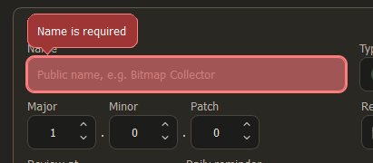

- **Red star.** Every field the validation requires gets a red `*` after its caption (`forms.labeled(text, widget,
  required=True)`); a panel whose content is required gets one after its title (`forms.panel(..., required=True)`).
  Optional fields have no mark; never mark a field the validation does not check.
- **Red outline.** A field with an error has the property `invalid="true"` (border `log_error`) and its message in
  the property `invalidMessage`. Lists and text boxes show it on their field frame (`controls.boxed`).
- **Error bubble** (`controls.ErrorTip` through `controls.ErrorHints`; outlined on every side, the arrow included,
  by `controls.paint_bubble`): a red bubble (`danger` fill, `log_error`
  border, `danger_text`, radius 7, a 6 px arrow) that floats up just above the field (below it when there is no room)
  with what is wrong. It appears only after the pointer **really moves** on the field (3 px), checked every 80 ms: Qt
  also sends Enter when a dropdown or a menu above the field closes and the pointer simply is there. It goes on Leave,
  Hide or a click. `ErrorHints.watch(widget)` once per field; `refresh(widget)` after the message changed. It casts the
  light system shadow of tooltips: `ErrorTip` inherits the empty `controls.QTipLabel` and is created with
  `Qt.ToolTip | Qt.FramelessWindowHint` (no `NoDropShadowWindowHint`). Never name the bubble class itself `QTipLabel`:
  the style sheet would then apply the `QToolTip` rule to it. The shadow stays while the bubble ignores the mouse and
  fades in.
- **Checked while typing.** A field with a format (a web address, an e-mail, a path, a number range) is checked on
  every edit, not only when the action runs: the outline, the bubble and the mini log show the error at once and go
  away as soon as it is fixed. What can be fixed for the user is fixed when the field is left: `forms.complete_url`
  turns `3dground.net` into `https://3dground.net` (and such an address is not an error while typing);
  `forms.url_error` says in a few words what is wrong ("Not a web address: type it as https://3dground.net", "A web
  address has no spaces", "The site name is not valid: ..."). An empty optional field is never an error.
- **Where errors are listed:** the mini log (below) and an error count on the tab ("Fields (2)"); the primary action is
  disabled while errors remain, in its coloured disabled shade.

## Buttons

`controls.Button(text, theme, icon=..., variant=..., tooltip=...)`; one class for all.

| Variant | Look | Use |
| --- | --- | --- |
| `secondary` (default) | `surface` fill, 1 px `border`, radius 6, padding 5 / 12 | Ordinary actions |
| `primary` | `accent` fill, `log_badge_text` text, bold; hover `focus`; disabled: `accent_disabled` with accent text | The one main action of a panel or window (Run, Build) |
| `danger` | `delete_background`, `delete_text`, `delete_border`; hover / pressed darker; disabled: `danger_disabled` | Remove, delete |
| `ghost` | Transparent, no border; hover shows `hover` fill and `border` | Status bar and toolbar actions |
| `donate` | `donate_background`, `status_button_text`, `donate_border`; hover `donate_hover` | Donate only |
| `field` | Field look, text on the left | A field that opens a picker (the date field) |

- States: hover `hover` + `active_border`, pressed `pressed`, focus `focus` border, checked `selected` + accent border
  (toggle chips), disabled `disabled_surface` / `disabled_text` / `disabled_border` without hover (coloured variants:
  see the rule above).
- Icon: original Lucide SVG, 16 px, tinted with the variant's text colour (disabled: `disabled_text`, or the coloured
  variant's disabled text), rendered at the device pixel ratio. An en space separates icon and text.
- Cursor: pointing hand only while enabled (updated on enable changes).
- **Icon-only buttons** in rows are 30 x 30 squares (`unify_heights`), always with a tooltip and an accessible name.
- A button inside a field (`toolFieldButton`): the field's height minus 6, 3 px from its right end, `surface` fill and
  `border`; the field gets a right text margin so text never runs under it.
- The primary action is pinned at the bottom of its panel or of the window, outside any scroll area.

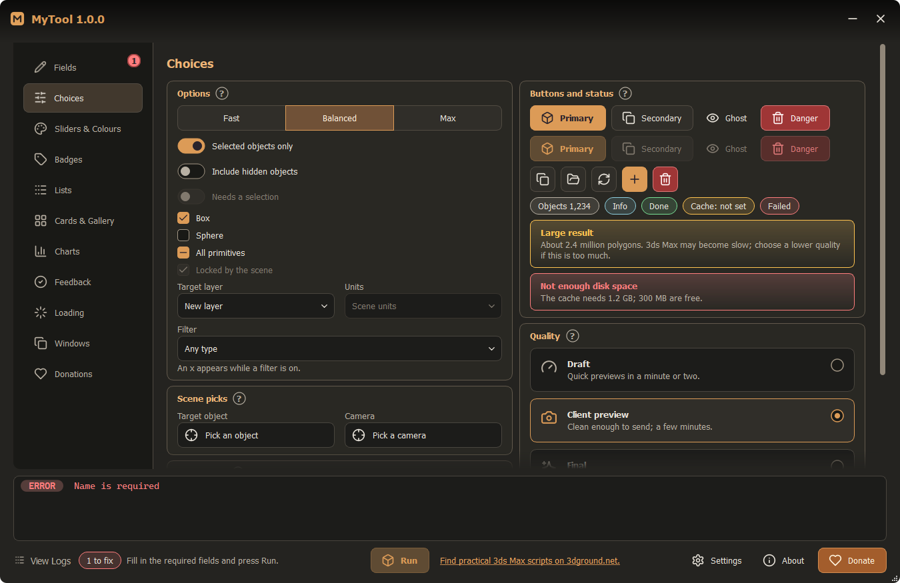

## Window buttons

`controls.WindowButton(icon, theme, tooltip, close=False, small=False)` for the title bar (Lucide `minus`, `x`): a
round 28 px button, transparent at rest, a soft `hover` circle with a `border` edge on hover. The close button turns red
on hover (`#9f3636`, pressed `#842d2d`, a light red edge) with a **white** cross, in every theme. `small=True` is the
22 px close button of the collapsed bar with a 14 px icon; it is selected in QSS through the property `compact`
(`QPushButton#toolIconButton[compact="true"]`). Never use a property named `size`: every widget already has Qt's own
`size` property, and a style rule on it silently never matches. No focus frame on round buttons.

## Status bar action: View Logs


The Logs window opens from **View Logs**, the first item on the left of the main window's status bar, as in MaxPkg
Runtime Manager (`controls.StatusAction("View Logs", theme, "logs", tooltip)`): a text action, not a button. Muted 11 px
text (`muted_text`) after the 12 px Lucide `logs` icon in the muted colour, padding 0 / 2, no background and no frame;
on hover only the text colour changes (to `text`); pointing-hand cursor; tooltip "See what Name did: steps, warnings and
errors". It keeps its own height (not 30 px). Pills and the status message follow it; Settings, About and Donate stay on
the right. A click opens the modeless Logs window.

## Segmented choice

`controls.Segmented(((key, label, tooltip), ...), theme, current)`: an exclusive row of checkable buttons (Fast /
Balanced / Max, All / Warnings / Errors, or the tab row of a window). Buttons are placed by hand, each overlapping its
left neighbour by 1 px, so borders never double; the checked one is raised so its accent border shows on every side.
First / middle / last segments square their inner corners. A negative layout spacing is *not* an overlap in Qt (it
means "style default"). The minimum width is the text widths plus a small margin, so the row fits narrow panels. No
focus frame on segments. As a tab row it may carry an error count in its caption ("Fields (2)").

## Switches and check boxes

- **Switch** (`ui/switch.py`, `Switch(theme, text)`): a 32 x 18 rounded track and a sliding knob, the label 9 px to its
  right. Off: `recessed` track, `checkbox_border` edge, `muted_text` knob; on: `accent` track and a knob in
  `log_badge_text`; the slide takes 120 ms (programmatic changes jump). Hover `active_border`, focus `focus`; disabled:
  `disabled_surface` and `disabled_text`. It behaves like a check box (`toggled`, `isChecked`, `setChecked`). **Use a
  switch for every on / off setting** (options, Settings, Live in the Logs window).
- **Check boxes** pick items of a list or a partly selected group: 13 px indicator, radius 3, `recessed` fill,
  `checkbox_border`, hover `checkbox_hover_border`; checked: `accent` fill with a tinted Lucide `check`; partly checked
  (tri-state): `minus`; disabled checked and unchecked states have their own icons and colours. Spacing 7 px to the
  text; pointing-hand cursor while enabled.

## Fields, dropdowns, pickers, lists

- **Fields** (`QLineEdit`, text edits): `field` fill, `field_text`, 1 px `field_border`, radius 6, padding 4 / 6,
  selection `selected` / `selected_text`; focus border `focus`; read-only `recessed`; disabled `disabled_text`. A
  read-only value that people copy (an ID) gets a Copy square and a chevron menu square for rare actions beside it.
- **Field frame** (`controls.boxed(widget)`): lists and multi-line text boxes sit inside a rounded `toolBox` frame that
  draws the border, the focus colour and the error outline (inside Max's frameless windows Qt does not paint a scroll
  area's own style-sheet border). `margin=0` puts rows against the border (the mini log).
- **Dropdowns** (`controls.ComboBox`): field look, 24 px right padding, Lucide `chevron-down` 12 px tinted (QSS needs
  icon files: the theme manager writes tinted copies per theme). The popup is a `QListView` (`toolPopup`): `popup` fill,
  padding 4, rows radius 4 with min height 20, hover and selection `selected`; the popup window is rounded by a mask. It
  opens 4 px below the field, or above when there is no room, clamped to the screen's work area; its list gets the
  window's font before Qt measures it. The wheel never changes the value (`wheelEvent` ignores it, so the page
  scrolls), focused or not.
- **Badge dropdown** (`forms.BadgeComboBox(theme, (("Added", "log_success"), ("Fixed", "log_warning"), ...))`): the
  value is a coloured capsule (fill `<role>_background`, bold text in `<role>`, 85 % size, centred on the capital
  letters), closed and open (`BadgeDelegate`); every badge is as wide as the longest name; the field is exactly the
  badge, a small gap and the arrow, and the open list has the same width. It re-fits when the font changes. Use it
  where a value is a category that is also shown as a badge in a list (changelog types, statuses).
- **Dropdown with icons** (`combos.IconComboBox(theme, ((value, label, lucide_icon), ...))`): a 16 px Lucide icon
  before every item, in the list and in the field, tinted again when the theme changes. For items of different kinds.
- **Dropdown with groups** (`combos.GroupedComboBox(theme, ((heading, ((value, label), ...)), ...))`): headings in small
  bold muted capitals without a hover; they cannot be chosen and the keys skip them; the items under them are
  indented 12 px. `value()`, `set_value(value)`.
- **Editable dropdown** (`combos.editable_combo(theme, items, owner, placeholder)`): pick a value or type a new one;
  a typed value is never added to the list; the completer matches anywhere, ignores case and belongs to the window
  (`owner`), as every completer of the tool. The text field inside has no frame of its own (the dropdown's frame is
  the field) and its text starts where a dropdown's does.
- **Dropdown with check boxes** (`combos.MultiComboBox(theme, ((value, label), ...), checked)`): for a few values that
  combine. A click ticks a row and the list stays open for the next one; Enter or a click outside closes it. The field
  sums it up: "None", the one name, two names ("Geometry, Materials"), "3 selected", "All". The rows' check boxes look
  like the tool's check boxes. `values()`, `set_values(values)`, `changed`.
- **Choice cards** (`combos.RadioCards(theme, ((value, title, text, lucide_icon), ...), value, columns)`): two to four
  exclusive choices whose difference needs a sentence. Each card: a 20 px icon (accent when chosen, muted otherwise),
  the title in bold, one muted line, a radio dot at the right; the chosen card has the accent border on `surface`;
  radius 8, inside 12. A click or Space chooses; the arrow keys move the choice, as radio buttons do. One column when
  the text is long, a row when it is short.
- **Stepper** (`pickers.Stepper(theme, minimum, maximum, value, pad=0, wrap=False)`): a whole number in one rounded
  field (40 px value, centred) with small up / down arrows (10 px Lucide chevrons, 18 x 12) stacked inside its right
  edge; arrows repeat while held; Up / Down keys step it; the wheel does not (it scrolls the page). `pad` shows leading
  zeros ("05"); `wrap` turns the maximum into the minimum and back (59 + 1 is 0). A version is three steppers with
  captions **Major**, **Minor**, **Patch** above them and a "." between them; raising a number resets the lower ones
  to 0.
- **Time field** (`pickers.TimeEdit(theme, QTime)`): hours and minutes as two wrapping steppers with two digits and a
  colon between them; `time()`, `setTime()`, `changed`.
- **Date field** (`pickers.DateField(theme, date=None, with_time=False)`): a `field` button with the Lucide `calendar`
  icon and `yyyy-MM-dd` (`calendar-clock` and `yyyy-MM-dd  HH:mm` with a time); a click opens `CalendarPopup` 4 px
  below (or above): rounded 8 px frame by a mask, inside 8. Three views in one frame:
  - **Days**: the title "November 2026" in `heading_text` bold between `chevron-left` / `chevron-right`, weekdays
    Mo..Su (Monday first) in 8 pt muted, day cells at least 28 x 26, radius 6 (other months `disabled_text`, today an
    accent outline, the selected day `accent` fill).
  - **Months**: a click on the title shows the twelve months of the year (Jan..Dec, 3 x 4 cells 40 px high); the
    arrows step a year; a month opens its days.
  - **Years**: a click on the year shows twelve years ("2022 - 2033"); the arrows step twelve years; a year opens its
    months. A date years away is three clicks off, never dozens of arrow clicks.
  The arrows and the wheel step a month, a year or twelve years by the view. Keys as in Windows' own calendar: Left /
  Right a day, Up / Down a week, Page Up / Down a month (with Shift a year), Home today, Enter picks, Esc steps back a
  view and then closes. "Today" goes to today. `set_range(minimum, maximum)` greys out the days, months and years
  outside it, and the keys never leave it. **With a time** (`with_time=True`): a time row under the days (Time, the
  time field, "Now"), and a click on a day only selects it; **Done** (primary, or Enter) applies the date and the time
  together and `changed` sends a `QDateTime`; "Today" sits at the left of Done. The steppers and buttons have the one
  control height (the popup levels them after its style sheet polish).
- **Completer lists** (search suggestions, `inputs.SearchBox`): the list is the tool's rounded popup and its rows start
  exactly where the field's text starts (`SuggestionDelegate`, set after `setPopup`, which replaces delegates). The
  completer and its model belong to the **window** (`SearchBox(..., owner=window)`), the list is created and handed
  over with `setPopup`, and the popup gets the style sheet and the interface-size font when it opens (it is a window
  of its own). A completer that was a child of its own line edit took 3ds Max 2022 down with a heap corruption once
  the window showed (see [Max reliability](max-reliability.md)).
- **Lists** (`QListWidget`, in a field frame): rows padding 4 / 8, radius 4, hover `hover`, selection `selected` /
  `selected_text`, no focus rectangle; a right-click opens the row's `Menu` and acts on the row under the pointer;
  Delete removes the selection. **Tables** (`toolTable`): alternate rows `surface`, header `surface` with `muted_text`
  and a bottom `border`; sorting only where meaningful, numbers stored as numbers.
- **Scene tree** (`tree.SceneTree(theme, columns)`, as 3ds Max's Scene Explorer): `add_layer(name, opened)` and
  `add_object(layer, name, kind, numbers, checked)`. A list's field look; a Lucide icon per kind (`layers` in the
  accent for a layer, `box`, `lightbulb`, `camera` in muted); theme chevrons (`chevron-right` / `chevron-down`) open a
  layer; a check box on every row, a layer's box showing a dash when only part of it is ticked and ticking all of it
  in one click; numbers right-aligned in their column; rows at least 22 px. A row's hover and selection are one
  rounded bar (radius 4) from the check box to the right edge, drawn by `SceneTree.drawRow`: the indent and the
  chevron stay unlit and the column seam shows no notch (the style sheet's own item fills are transparent; Qt 6 lit
  the indent of a selected row whatever `show-decoration-selected` said). The chevrons are drawn by `drawBranches`.
  `checked_names()`, `checked_changed`.
- **Drop zone** (`tree.DropZone(theme, (".png", ".jpg", ".exr"), title)`): a dashed rounded area on `recessed` with the
  Lucide `upload` icon, a bold title ("Drop images here"), the kinds it takes ("PNG, JPG or EXR, or choose them") and
  Browse (the system file picker). While files are dragged over it: the accent outline and "Drop 2 files" for files it
  takes (with how many others will be skipped), the red outline and "Only PNG, JPG or EXR" for files it does not; it
  goes back when the drag leaves. It sends only the paths it takes (`dropped`); `take(paths)` does the same from code.
  A drag it does not take is still accepted on enter without a drop action, with "not allowed" on move: a drag ignored
  on enter never tells the widget that it left, and the red state would stay.

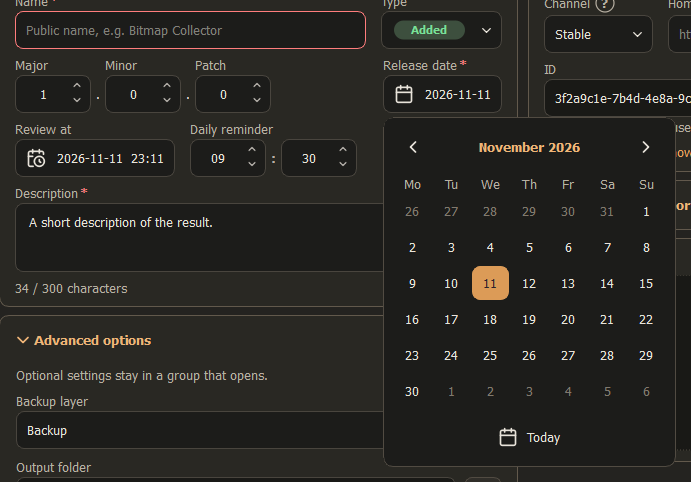

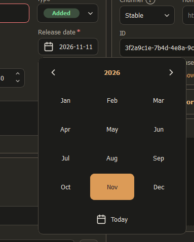

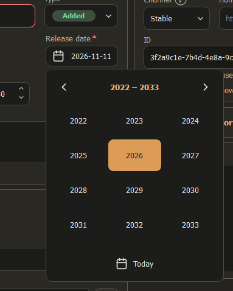

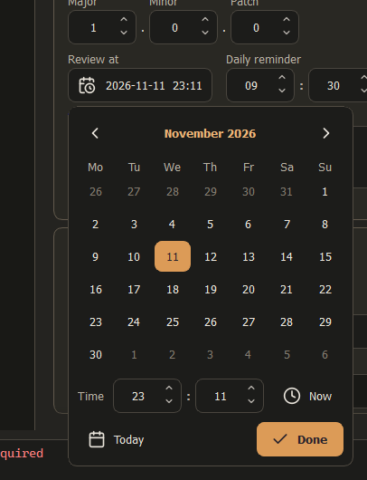

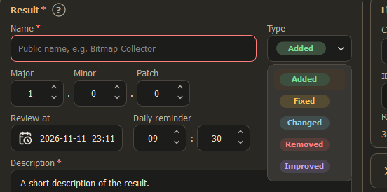

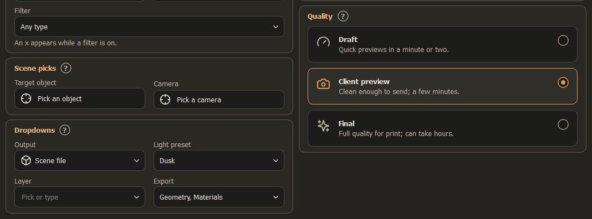

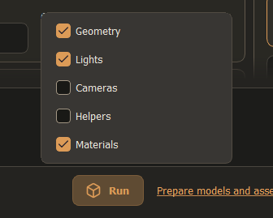

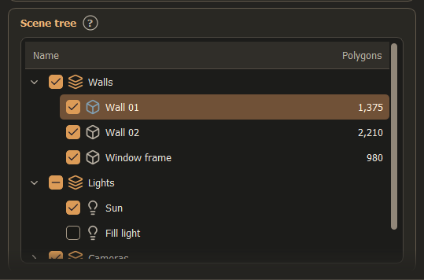

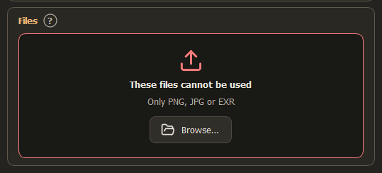

## Sections: tabs or a list on the left

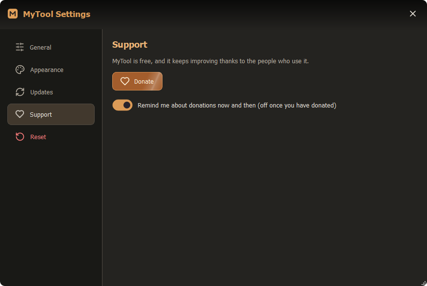

`sections.SectionBook(theme, side)` holds pages with one chooser; `add_page(key, title, icon, danger=False)` returns the
page's layout, `show_page(key)` and `changed(key)` work in both styles. **Tabs on top** (`side=False`) suit two or three
short sections. **A list on the left** (`side=True`), as in the MaxPkg Package Manager's Settings, suits four or more
or long names: a recessed column (`toolNav`, 168 px, a `border` line on its right), buttons with a 15 px Lucide icon and
the name (`toolNavButton`: muted at rest, `surface` on hover, `hover` fill with a `border` edge when chosen), a red item
for a destructive section (Reset, Uninstall) last; each page shows its title (`toolPageTitle`) and scrolls with soft
edges. `choose_side(count)` gives the default: the list from four sections. A count badge may sit on a section (the
trainer's Fields shows its errors). The main window uses the same widget when it has many sections (the trainer).

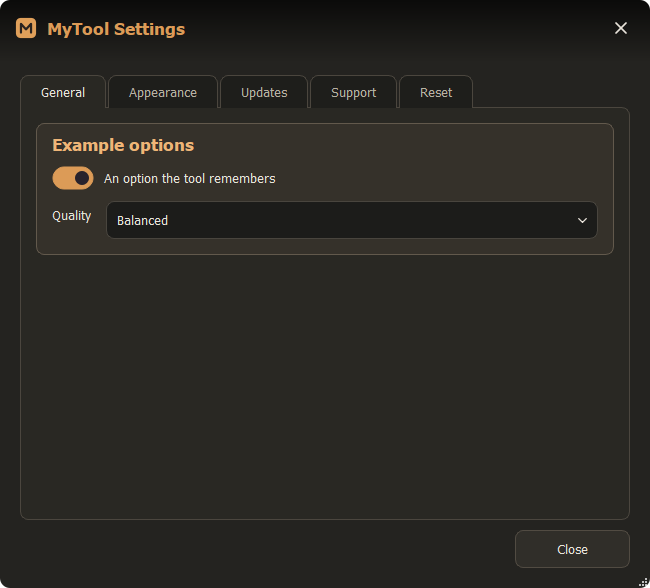

## Sliders

`sliders.Slider(theme, minimum, maximum, value, step, decimals, suffix)` and `sliders.RangeSlider(theme, minimum,
maximum, low, high, ...)`: 30 px high like every control; a 6 px rounded track in `recessed` with a `border`, the
chosen part in `accent`, round 16 px handles in `text` with a 2 px accent edge (a soft accent ring under the pointer or
with the focus), and the value in a small field-coloured label at the right ("80 %", "20,000 - 120,000"). Drag a
handle, click the track (the nearest handle jumps there), or use Left / Right, Page Up / Down, Home / End; the two
handles never pass each other. **The wheel never changes a value** (it scrolls the page). Each handle gets the same
soft accent ring under the pointer (the painter's pen is cleared before every ring, or the second handle inherits the
first one's edge). Disabled: grey track, `accent_disabled` fill. `valueChanged(float)` / `rangeChanged(low, high)`.
`vertical=True` stands a slider or a range up like a mixer's fader: the smallest value at the bottom, the value label
under it, as wide as that label; Up raises it.

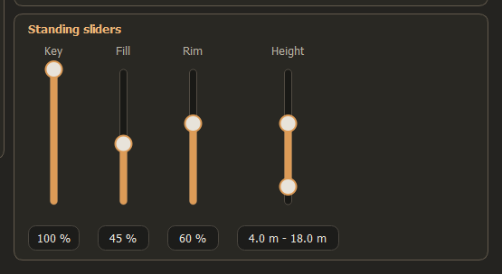

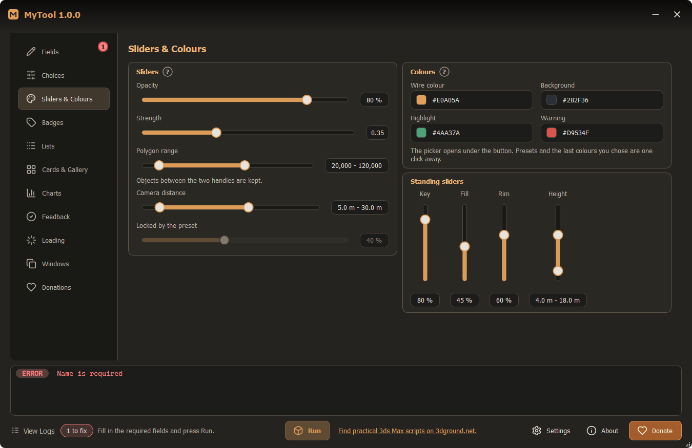

## Colour picker

`colors.ColorButton(theme, "#e0a05a")`: a field-look button with a 16 px rounded swatch and the hex value. A click opens
`ColorPopup` below it (above when there is no room): a rounded card (`toolPopupFrame`, radius 8 by a mask) with a
saturation-value square, a hue strip, a **HEX | RGB | HSV** switch with the **pipette** at its right, the preview and the
value in the chosen format below it (HEX: one field, only hex digits, its validator parented to the field; RGB: three
steppers 0-255; HSV: hue 0-359 degrees, saturation and value 0-100 %; each with a small caption; all formats, the square
and the strip stay in step and the chosen format is remembered; the switch fills its row so no label is clipped), a
**colour harmony** of the current colour (complementary, analogous, triad, split complementary, tetrad or shades,
chosen in a dropdown and remembered; up to five wide swatches that follow every change; a click takes one and keeps the
palette open), twelve preset swatches and the last colours chosen
("Recent", shared by every colour field of the tool). The colour changes live while choosing; Esc puts back the colour
it opened with; Enter or a click outside keeps the new one. The card casts Windows' light popup shadow along its
mask. `colorChanged(str)`.

**Pipette** (`colors.ScreenPicker`): the palette steps aside, every screen is shown frozen as it was (an opaque picture
in a window per screen, never a translucent window) with the cross cursor and a loupe beside the pointer: 11 x 11
pixels enlarged in a rounded card, the centre pixel framed, its swatch and `#rrggbb`. A click (or Enter) picks the pixel,
Esc or the right button cancels; the palette opens again at its place with the picked colour (or the one it had). The
mouse wheel zooms the loupe (4x to 24x, shown beside the colour, remembered); the loupe keeps its size.
Max's hotkeys are off while it picks. The screen pictures stay in memory only while picking and are never saved.

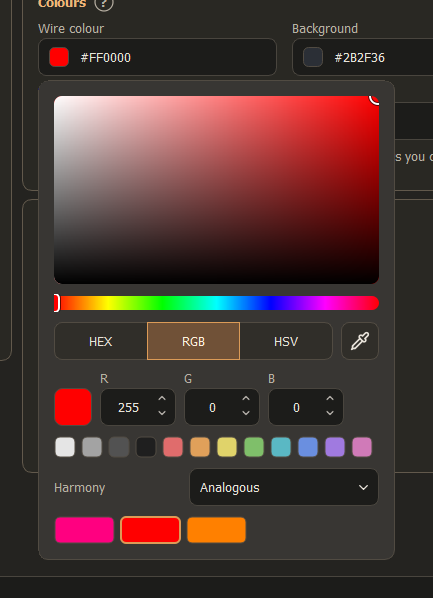

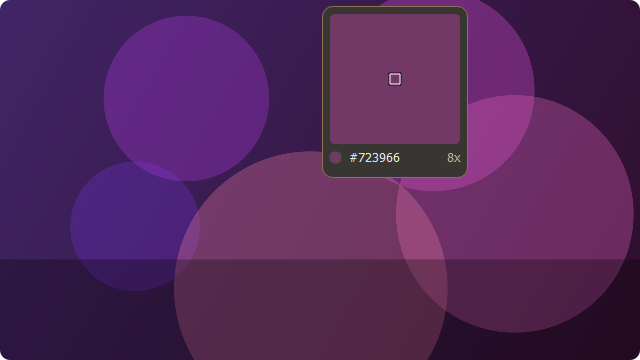

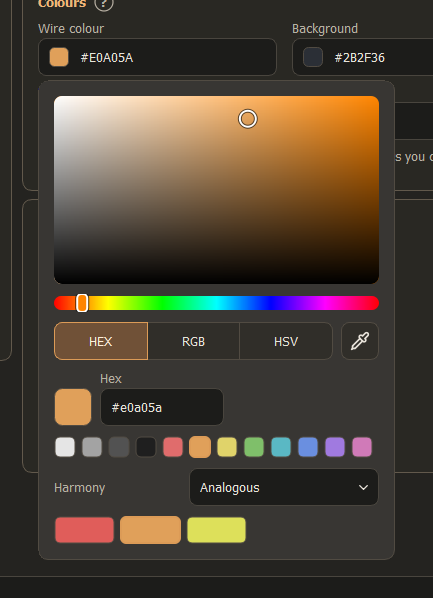

## Badges, tags, dots and filter pills

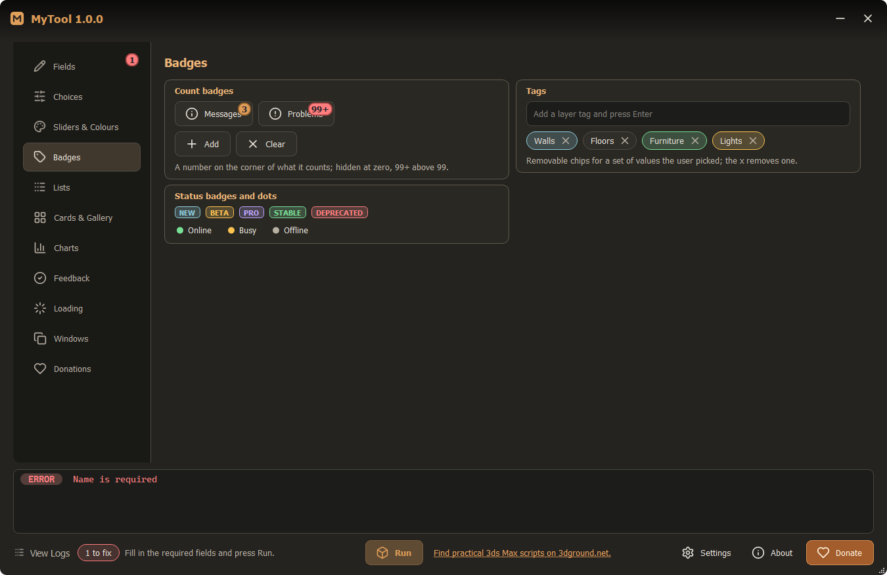

- **Count badge** (`badges.CountBadge(target, theme, role="log_error")`): a number in a round bubble inside the top-right
  corner of a button or a section, edged in a quiet darker shade of its own colour (the same hue, a little deeper, at
  about 60 % of its brightness: a dark burgundy edge on a red badge; never black, never white, never a contrasting
  ring); hidden at 0, "99+" above 99. Red for problems, `accent` for news. It follows the target and lets clicks
  through.
- **Status badge** (`StatusBadge(theme, "Beta", "log_warning")`): a short upper-case word in a tinted capsule beside a
  name (NEW, BETA, PRO, DEPRECATED).
- **Tag** (`Tag(theme, "Walls", role=None)`): a removable chip with an x (hover circle, `removed(text)`), for a set of
  values the user picked; type a value and Enter to add one.
- **Status dot** (`Dot(theme, "Online", "log_success", pulse=True)`): a coloured dot and its label; a soft ring breathes
  around it while something is live. The dot sits on the middle of the label's capitals (baseline minus half the cap
  height), not on the middle of the line box: the font's ascent keeps room above the letters, and a dot on the box's
  middle looks a few pixels high.
- **Filter pills** (`FilterPills(theme)`, `add(key, label, icon, colour, count)`), as the MaxPkg Package Manager's
  collections: each pill a capsule tinted with its own colour, a Lucide icon, the name and a count in a soft bubble.
  While "All" is chosen every pill keeps its colour; choosing one dims the others to neutral and the chosen one glows;
  a click on the chosen pill goes back to All. Use them to filter a grid or a list by category, not to move between
  pages.

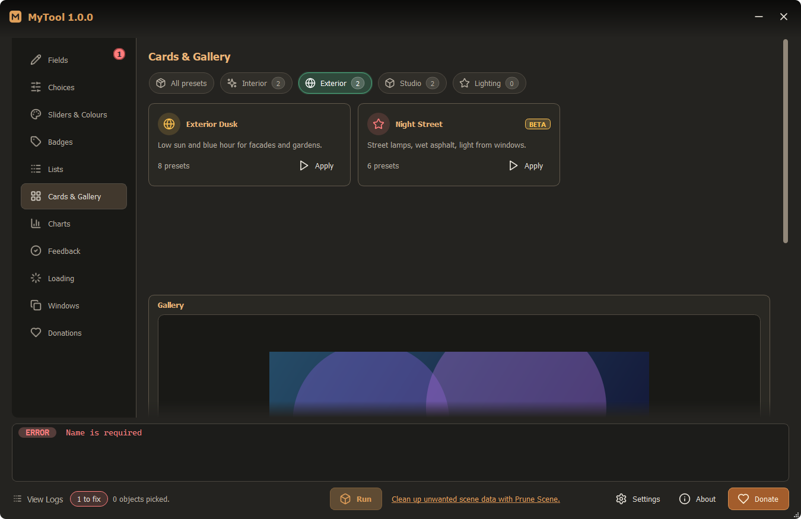

## Search, copy, filters and the list editor

- **Search** (`inputs.SearchBox(theme, placeholder, suggestions, owner=window)`): the Lucide `search` glyph inside the
  left end, a small x at the right while there is text (Esc clears too), suggestions while typing (contains, any
  case), `search(text)` 300 ms after the last key or on Enter. When nothing matches, show an empty state with Clear
  Search in place of the list.
- **Copy button** (`inputs.CopyButton(theme, text_or_callable, tooltip)`): a square; after a click the icon turns into a
  green `check` for 1.4 s and the tooltip says "Copied". No toast when the result is in view.
- **Clearable dropdown** (`inputs.ClearableComboBox(theme, choices, default)`): a dropdown with a square x beside it that
  appears while the value differs from its default ("Any type"); the field gets an `accent` outline while a filter is
  on (`active="true"`).
- **Pick button** (`inputs.PickButton(theme, prompt, kind)`), as MAXScript's `pickbutton`: a field-look button with
  the Lucide `crosshair`; a click shows "Click an object in a viewport" in the accent colour and starts 3ds Max's own
  pick mode (`pickObject` on the main thread, the prompt in Max's prompt line; Esc or a right click cancels); the
  picked object's name then stands on the button with a small x that clears it. `kind` limits it to cameras, lights,
  geometry or shapes. It keeps the node's anim handle, never the node. Tests replace the pick: it waits for a person.
- **Multi-select list** (`inputs.MultiSelectList(theme, items)`), as 3ds Max's MAXScript `multiListBox`: press on an
  item and drag up or down to select the run under the pointer (the list scrolls by itself at its edges), Ctrl+click
  adds or removes one, Shift+click extends, Ctrl+A selects all. The order never changes (no drag to reorder). Below it
  a muted "5 of 24 selected" and Select All / Select None; `changed(texts)`; soft edges in the field colour. Use it
  where the user picks several items of a fixed list (objects, layers, cameras); use the reorderable list where the
  order is the user's to set.

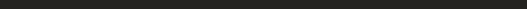

- **List editor** (`inputs.ListEditor(theme, placeholder, values, check)`): a field with Add (Enter) and a paste square
  that adds many lines at once, a list in a field frame (double-click edits, drag reorders, Delete or the row menu
  removes), a muted count and Remove All. Duplicates and values that fail `check` are refused with the reason in red
  under the field; pasted lines report how many were skipped.

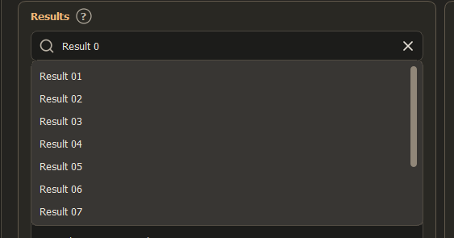

## Links and the rotating link

- **Link** (`controls.Link(theme, text, url, on_click, external)`): a plain hyperlink in the `link` colour, underlined
  under the pointer or with the keyboard focus; a click (or Enter / Space) opens the page in the browser or, with
  `on_click`, a window of the tool. A page outside the tool gets the small Lucide `external-link` icon after the text.
  Links are for going somewhere; actions that change something are buttons.
- **Rotating link** (`controls.PromotionLink`, package `PROMOTIONS`), as in MaxRewind, TerraScoop and Max Ultra MCP:
  between the status message and the buttons on the right, one of the owner's messages at a time, a new one every 30 s
  in shuffled order and never the same twice in a row, the long text when it fits and the short one otherwise,
  underlined in `support_link`; a click opens its page. Only the owner's own sites and tools, and a donation request
  if they want one; `()` turns it off.

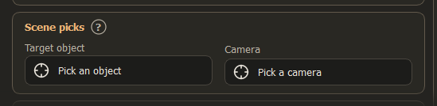

## Cards and gallery

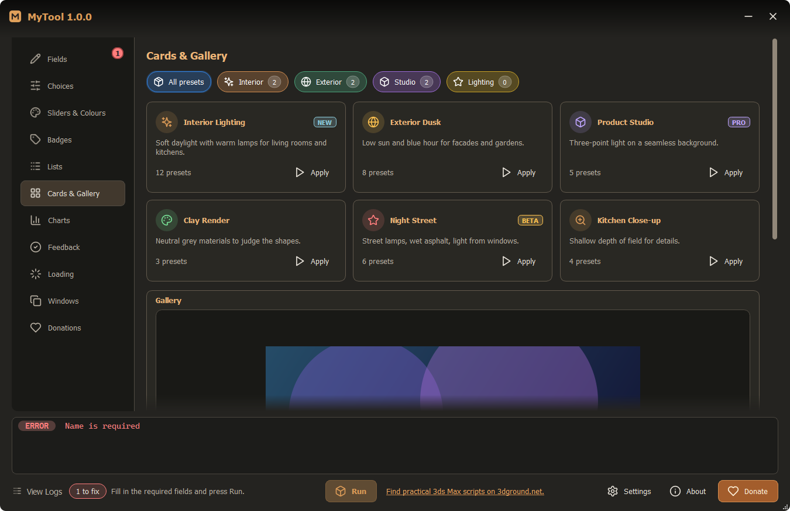

- **Card** (`cards.Card(theme, title, text, icon, role, badge, detail, action)`): `toolCard` (`tab_pane_background`,
  `group_border`, radius 8; the outline turns `accent` under the pointer), an icon on a tinted disc, the bold name, an
  optional status badge, two lines of muted description, a small detail and one ghost action. The whole card is
  clickable (`clicked`).
- **Card grid** (`cards.CardGrid(min_width=220, max_columns=4)`): equal columns from the width, the cards of a row as
  tall as the tallest; hidden cards (a filter) take no place (`relayout()`).
- **Gallery** (`gallery.Gallery(theme)`, `add(pixmap, title, caption)`), as in the MaxPkg Package Manager: the current
  picture in a rounded `recessed` frame that follows a sideways drag with its neighbour sliding in (a drag past 40 px or
  the arrow keys go on, a shorter one springs back; it loops); round previous / next buttons over its sides and a
  "2 / 6" counter in its corner (painted dark see-through discs and capsule, so they read on any picture); the title
  and caption below; a strip of rounded thumbnails that scrolls by dragging, the current one framed in `accent`.
  Pictures are never enlarged. A picture still loading shows a spinning ring; one that failed shows `image-off` and
  a short line. Show pictures the tool made (renders, previews); `cards.demo_picture` paints neutral examples.
- **Lightbox** (`gallery.open_lightbox(window.full_view, theme, items, index)`): the pictures over the whole content
  of the window below its title bar, on a blurred copy of it tinted with `recessed` that fades in; large round
  previous / next buttons, the round close button (red on hover), the bold title and the muted caption at the bottom.
  Esc, a click beside the picture or on the backdrop, or dragging the picture up or down past 110 px (the backdrop
  fades and the controls step aside while it moves) closes it; Left / Right and sideways drags step. A child widget,
  never a translucent window.

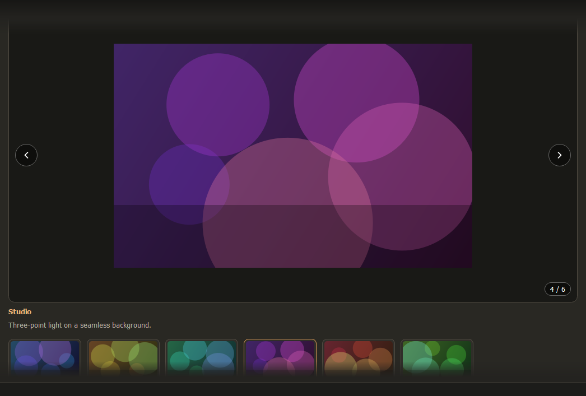

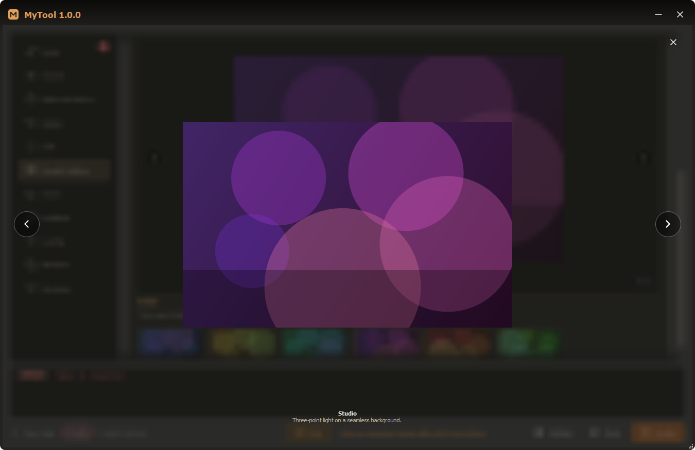

## Area states: busy, result, empty

- **Busy overlay** (`states.BusyOverlay(area, theme)`, as the MaxPkg Package Manager): `start(title, hint)` covers the
  area with a blurred, tinted snapshot of itself and a glass card (radius 14) with the animated status icon, what runs,
  a calm hint ("This usually takes a few seconds.") and Cancel (`cancelled`, also Esc); `finish(kind, "Title
rest")`
  shows the tick or the alert for a moment and goes. The area is blocked while it shows.
- **Result card** (`states.ResultCard(area, theme)`, as MaxRewind): `show_message(kind, title, text, ms, donate_note)`
  puts the outcome of a finished main operation in the middle over the blurred, dimmed area: a 34 px round icon in the
  result's colour, a bold title, a muted line, and a 3 px bar that runs down to the close (it waits while the pointer
  is on the card). After a success it may carry a donation line and a shimmering Donate ([donations](donations.md)).
  A click elsewhere closes it. Use it for the end of the main action; small outcomes stay toasts.
- **Empty state** (`states.EmptyState(theme, icon, title, text, action, role)`): a 26 px icon on a tinted 56 px disc, a
  section title, a hint in help markup and one action ("No results" + Clear Search, "You are offline" + Retry, "No
  presets in this category" + Show All).

All three are child widgets of the area they cover, never translucent windows.

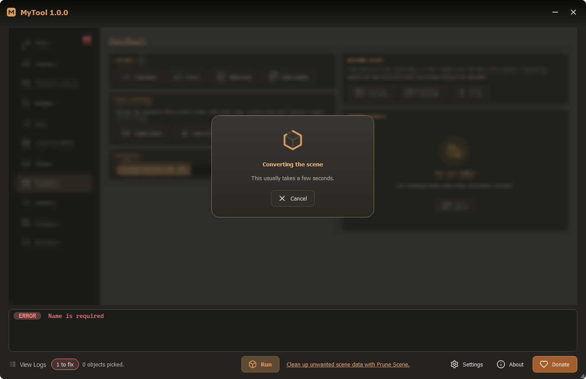

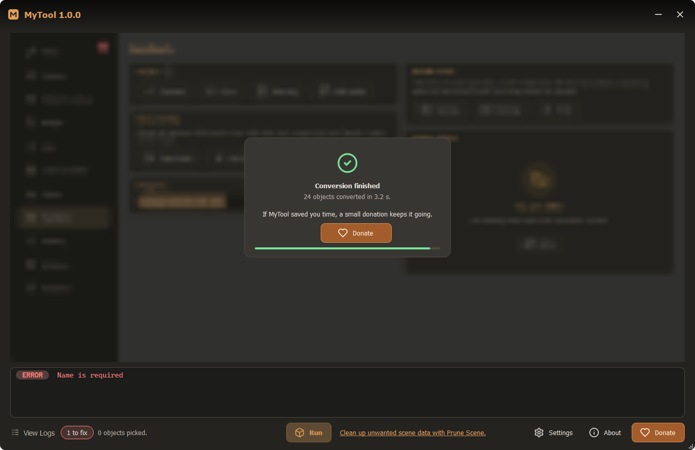

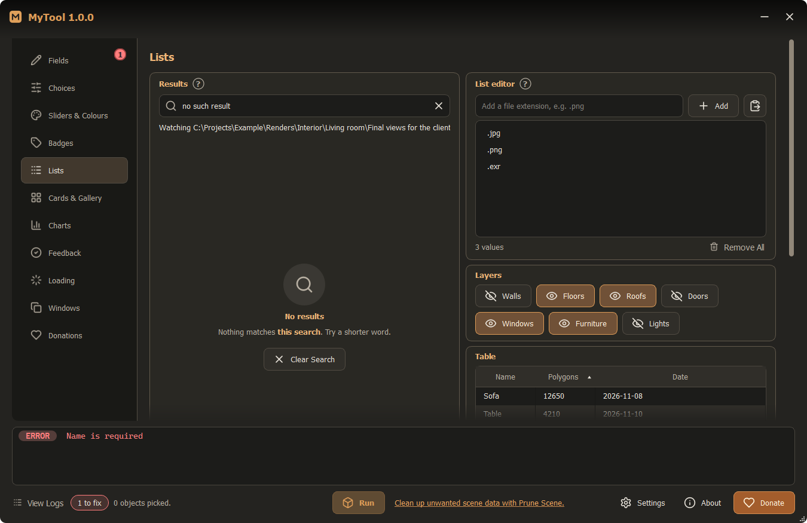

**StateArea** (`states.StateArea(content, empty)`, `set_empty(True / False)`): a list (or a grid) and its empty state
in one place, a stacked layout as tall as the taller of the two. The empty state takes the list's own room, centred,
so the search field above and everything below stay where they were while the user types. The trainer's search and
its card filter use it; the skeleton rows of the Loading section too.

## Soft edges of scrolling areas

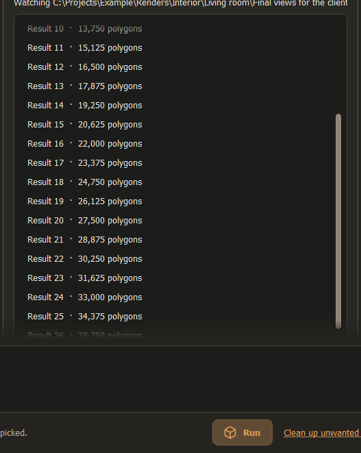

`controls.EdgeFade(area, theme, edge, role)` and `controls.fade_edges(area, theme, role)`: a 22 px band in the colour
behind the area (`window` for a page, `tab_pane_background` inside a panel, `field` in a list box) laid over the
content with an alpha ramp, so the content fades out instead of being cut off. The top edge shows once the area is
scrolled, the bottom edge while more is below; mouse events pass through. Section pages, `forms.scroll_page(widget,
theme)`, About and long lists use it.

## Scroll bars

Thin, no visible track, a pill thumb rounded over its whole width (see the list on the Lists tab):

```css
QScrollBar:vertical { width: 10px; background: transparent; border: none; margin: 0px; }
QScrollBar::handle:vertical { background: @scroll_thumb; min-height: 28px; border-radius: 3px; margin: 2px; }
QScrollBar::handle:hover { background: @scroll_hover; }
QScrollBar::handle:pressed { background: @scroll_pressed; }
```

The thumb is 6 px (10 - 2 x 2) and its radius exactly half of it. Keep that ratio when changing sizes: every px in the
style sheet is scaled and rounded on its own, and Qt draws a **square** thumb when the radius exceeds half the thumb
(a 8 px bar with a 3 px radius became 7 px wide with a 4 px radius at 125 % and lost its rounding). Clear arrows,
add-line / sub-line and add-page / sub-page; make `QAbstractScrollArea::corner` and scroll-area backings transparent.
Check the thumb in a zoomed screenshot at 100 %, 125 %, 150 % and 200 %.

## Toasts

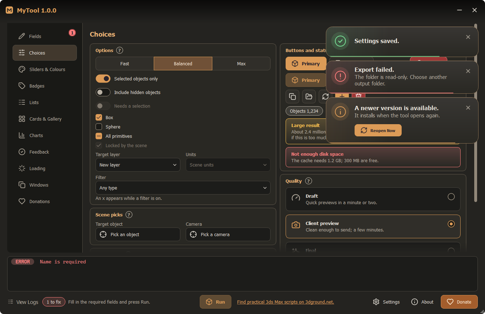

`window.notify(text, kind, action=None, key="")` (`ui/toast.py`, as in MaxPkg Runtime Manager): a notice about the
outcome of an action the user started. An opaque rounded card (radius 14, 340 px wide; a vertical gradient from `popup`
to `tab_pane_background`, a faint wash of the toast's colour from the left, an `active_border` edge and a bright top
line) inside the window, below the header at the right; several stack downwards 8 px apart. On the left an animated
status icon on a tinted disc (`StatusIcon`: success draws a circle and a tick with a small spring, error draws an alert
that shakes, warning hops, info draws an "i"); a bold first line (`text`, 13 px) and a muted rest (12 px) from
`"First line\nrest"`; optional action buttons (the first primary); a 22 px close button. A thin bar along the bottom in
the toast's colour shows the time left: 5.2 s, warnings 6.5 s, errors 8 s, 3 s more with an action; the time waits
while the pointer is over the toast; a click anywhere closes it. It slides in 28 px from the right and fades in. A
toast with an open `key` is shown again for its full time instead of a second one; raw web addresses are removed. No
toasts over the collapsed bar.

Use toasts for results (copied, saved, built, failed with the reason). Never for what blocks work (the mini log and the
field show that), never as a question.

## Questions, messages and prompts

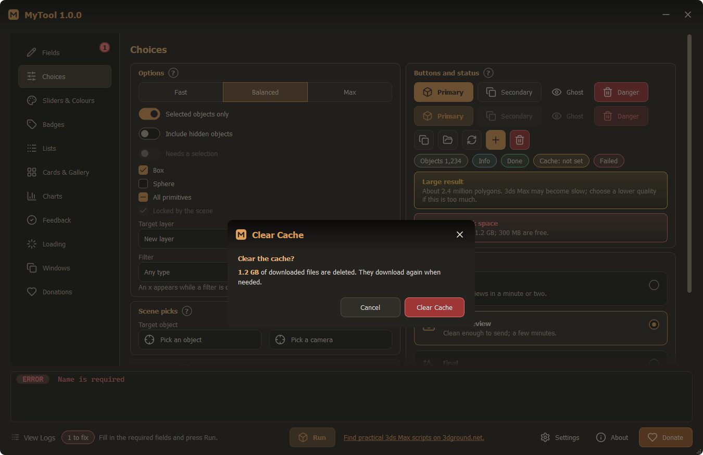

`dialogs.ask(controller, parent, title, question, detail, action, cancel="Cancel", danger=True)` -> True when the action
was chosen (`ConfirmDialog`, modal, 380 px wide): the tool's title bar, the question as a section title, the detail in
help markup, then the neutral button (the default: Enter or Esc keep things as they are) and the action, red when it
destroys something. Ask before deleting, clearing or overwriting, and before closing while work runs ("Work is
running." / "Cancel It and Close" / "Keep Working"). Never a `QMessageBox`.

`dialogs.inform(controller, parent, title, message, detail, kind, button="OK")` (`MessageDialog`, 400 px): the animated
status icon on a tinted disc (info, success, warning, error), the message as a section title, the detail in help
markup, one button. Use it only when the user must read it before going on (a failed save); otherwise a toast.

`dialogs.ask_text(controller, parent, title, label, text, placeholder, check, action)` -> the text or None
(`InputDialog`, 380 px): a caption, the field checked on every edit by `check(text)` (the reason in red under it, OK
disabled while it is wrong; an empty field is not an error before the user typed), Cancel and the action.

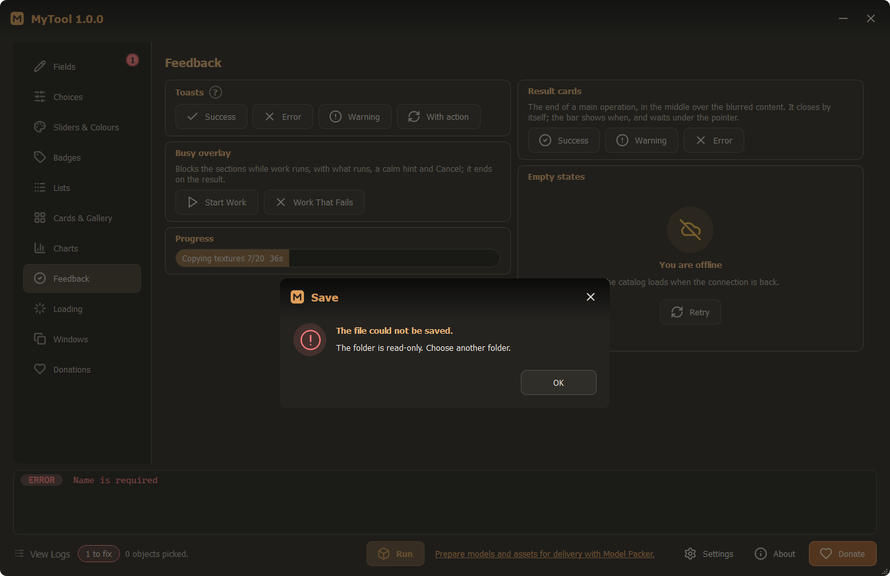

The **welcome window** (`dialogs.WelcomeDialog`, first start only) is not a second About: the brand icon centred on a
soft accent glow that fades out inside its block, "Welcome to Name" and the subtitle centred below it, no hero plate
and no accent line; then three points (`WELCOME_POINTS`: a Lucide icon on an accent disc, a bold title, one line in
help markup) and Open Settings / Get Started (primary), one size. `()` turns it off.

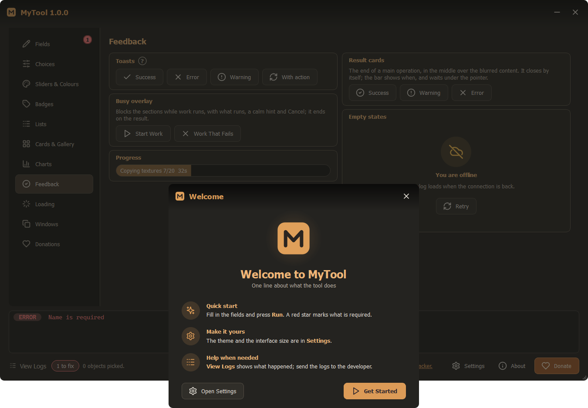

The **Support window** and every other donation offer are in [donations](donations.md).

## Menus

Context menus and the menus of chevron buttons are one control, `controls.Menu(theme, parent)` with
`add_item(text, lucide_icon, slot, danger=False, enabled=True, shortcut="")`:

- **Rounded.** The menu window has the `popup` fill, a `border`, radius 6 by a window mask (never a translucent
  window), inside 4, no system shadow, and the window's interface-size font (`fit_fonts` before it opens;
  `popup_at(point)` does it). Rows are rounded too (radius 4).
- **Rows** (`controls.MenuItem`): a 16 px Lucide icon, the text, and the key that does the same at the right in muted
  text ("Ctrl+C", "F2", "Del"); padding 6 / 16 / 6 / 8, at least 120 wide. A shown key must work without the menu:
  bind it with a `QShortcut` on the window or the list, the menu only shows it.
- **The current row** (under the pointer, or moved to with the arrow keys) has the rounded `selected` fill with
  `selected_text`. Up / Down move over the enabled rows only (a disabled row is skipped), Home / End jump, Enter or
  Space runs the row, Esc closes the menu.
- **Disabled rows** in `disabled_text` with a grey icon, never highlighted.
- **Destructive rows** (Delete, Remove, Clear Logs) come last, after a separator: red text (`log_error`) and a red
  icon. As the current row they take the red fill of a Delete button (`danger`) with light text and icon
  (`danger_text`), `danger_pressed` while pressed, so the user sees what the click does before it. A destructive row
  still asks first when it cannot be undone (`dialogs.ask`).
- **Separators** (1 px `border`, 4 px above and below, 6 px in from the sides) split the rows into groups: what the
  row is (Copy, Rename), then what removes it.
- **Where it acts.** A right-click selects the row under the pointer first and the menu acts on that row. Rare actions
  of a row (paste, regenerate) go into a chevron menu button, so the row stays short. Keep a menu short (up to about
  eight rows); a longer one needs groups or another place.
- **Text fields' own menu** (Undo, Cut, Copy, Paste, Delete, Select All) opens in the same look: `controls.text_menus`
  (called by `unify_heights`, so every field, text box and stepper of a window gets it) shows Qt's standard menu
  through `controls.round_menu`: frameless, no shadow, rounded by a mask, the window's font, coloured by the style
  sheet. A field with its own menu (`CustomContextMenu`) keeps it.

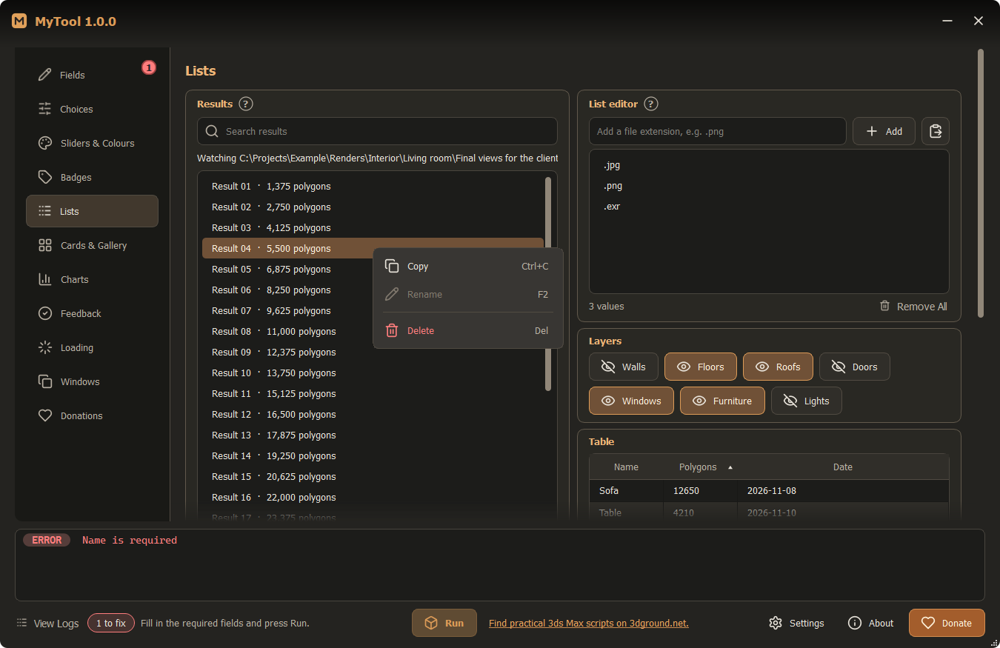

## Charts

Simple statistics in the tool's look (`charts.py`), drawn with QPainter in the theme's ink. The data colours are one
fixed categorical palette (`charts.SERIES`: blue `#3987e5`, orange `#d95926`, aqua `#199e70`, yellow `#c98500`,
magenta `#d55181`, green `#008300`, violet `#9085e9`, red `#e66767`), assigned in this order and never cycled; a ninth
series folds into "Other". The order was checked with a colour-vision validator on every theme's panel colour
(neighbours stay apart for the common colour-blindness types). On the 3ds Max theme's grey panel several colours sit
below 3:1 contrast, so a chart never relies on colour alone: the legend, the labels and the tooltips carry every value.

- **Stat tile** (`StatTile(theme, label, value, unit, delta, period, up_is_good, trend)`): the label in muted text,
  the value large and bold (15 pt at 100 %, in full under 10,000 and compact above: 1,284 / 12.8K / 4.2M), the change
  against a named period with an arrow ("▲ +8% vs last week"), green when the change is good and red when it is not
  (`up_is_good=False` for render time or errors: a fall is green), and an optional 12-point sparkline of the trend in
  the muted ink with the last point in the accent. Tiles in a row share a height and keep their content at the top.
- **Column chart** (`BarChart(theme, ((label, value), ...), unit)`): columns from one baseline, at most 24 px wide
  (never filling the slot) with a 4 px rounded top and a square base; one series in the first colour, no legend (the
  panel title names it); hairline gridlines one step off the panel; clean tick values (0 / 200K / 400K); the value of
  the largest column and of the hovered one on its cap; the whole slot is the hover target; the hovered column stays
  full and the others fade a little; a tooltip with the exact value.
- **Line chart** (`LineChart(theme, labels, ((name, values), ...), unit)`): 2 px lines with round joins, a wash of the
  colour (about 12 %) under a single series, a legend above for two or more; the end point ringed in the panel
  colour; the labels of the axis only where they fit side by side; hovering shows a crosshair, the points of every
  series on it and a tooltip with their values.
- **Donut** (`DonutChart(theme, ((name, value), ...), caption, unit)`): parts of one whole clockwise from the top with
  2 px gaps in the panel colour, the total and its caption in the middle, a legend at the right with each share; the
  hovered part grows a little and its name turns bold; a tooltip with the name, the value and the share. At most six
  parts; more fold into "Other".
- **Rules for every chart.** One value axis, never two. Text never wears a data colour: labels, values and legends use
  the text colours, and a swatch beside them carries the colour. Label selectively (the largest, the hovered, the end
  of a line), never a number on every mark. Use a chart only when the shape says something; one number is a stat
  tile.

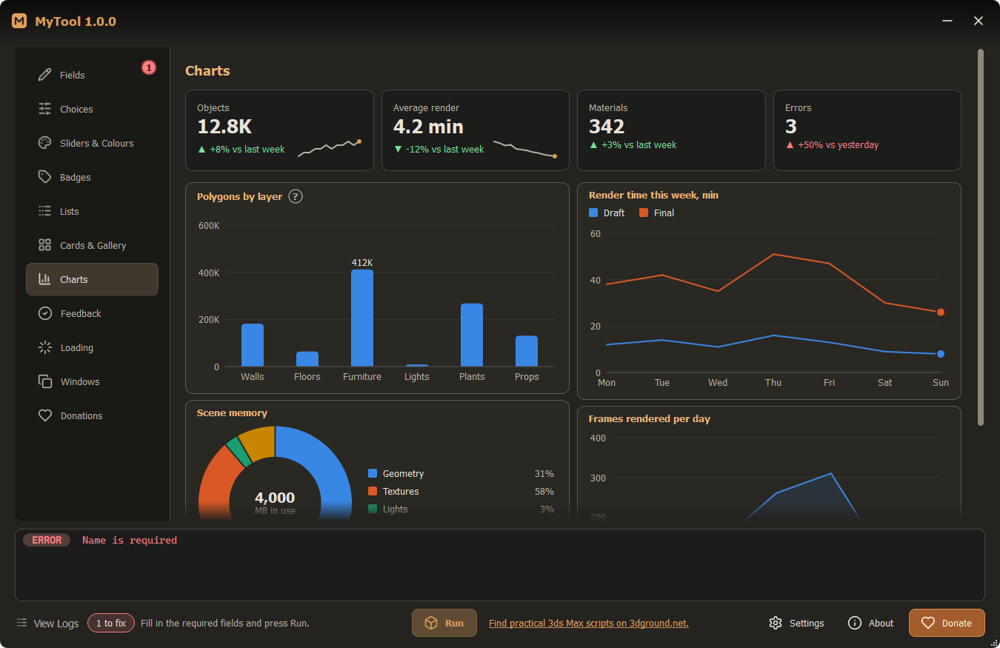

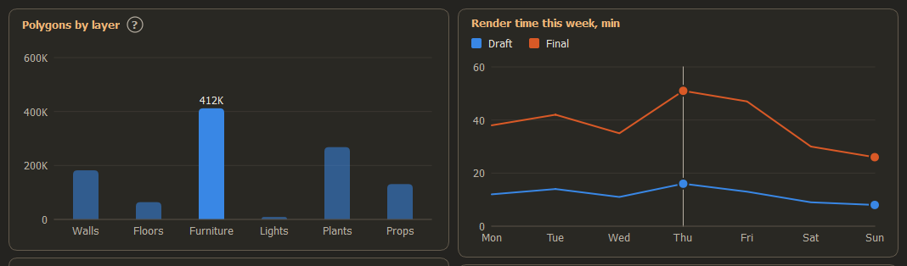

## Loading

Show that something is on its way, in the smallest form that fits (`loading.py`):

- **Spinner** (`Spinner(theme, size)`): a faint ring with an accent arc that turns and breathes in length; 16 px beside
  a line of text ("Loading presets…"), 24-40 px in the middle of an area with a line under it. Its timer runs only
  while it is visible.
- **A busy button** (`busy(button, True, "Refreshing…")` and `busy(button, False)`): the button that started work shows
  a spinner where its icon was, says what runs and cannot be clicked again; then it gets back its own text, icon and
  state. It keeps its size.
- **Skeleton** (`Skeleton(theme, lines, avatar)`): grey rounded bars (and a round picture place) where content will
  appear, with a soft light sweeping over them; put it and the content in one `states.StateArea`, so the layout does
  not jump when the content arrives.
- **Progress ring** (`ProgressRing(theme, size)`, `set_value(share)` or `None`): a ring that fills with the known share
  and prints it in the middle, or spins while the share is not known. For a small place; the status bar keeps the
  progress bar.
- **Steps** (`Steps(theme, names, current)`, `set_current(index)`, `state(index)`): the steps of a short wizard in a
  row. The current step is the loudest mark: a solid accent disc with its number in `log_badge_text`, a soft accent
  halo (4 px, 28 % alpha) and its name in bold. Done steps step back: an accent tint (22 %) with an accent check and
  their name in the text colour. Steps to come: a grey 1.5 px ring, a muted number and name. The joining line is
  accent up to the current step and `border` after it. Never make a done step louder than the current one.

Use the progress bar (status bar) for long work and the busy overlay when work blocks a whole area; these are for the
small cases. Never invent progress: a ring without a known share spins.

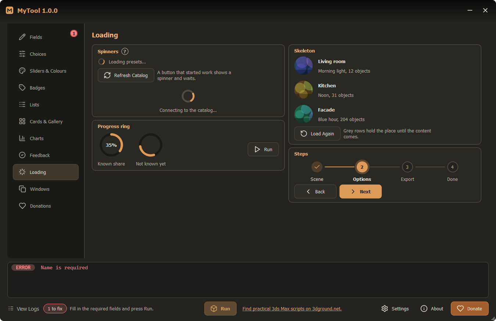

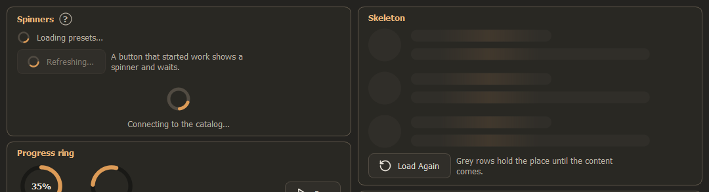

## Status pills

`controls.Pill(theme, text, variant)`: a capsule painted once (height = font height + 8, horizontal padding 10, radius =
half the height). Border in the tone colour, fill the same tone at alpha 40, text `text`. Tones: `neutral` ->
`muted_text`, `info` -> `log_info`, `success` -> `log_success`, `warning` -> `log_warning`, `error` -> `log_error`.
Long text elides in the middle; the full text is the tooltip and the accessible name. Minimum width 64, so a pill never
widens its column. `set_clickable(True)` makes it a button (pointing hand, `clicked`): the state pill of the bottom
strip shows or hides the mini log. Keep numbers in short labels ("Objects 1,234", "2 to fix").

## Progress

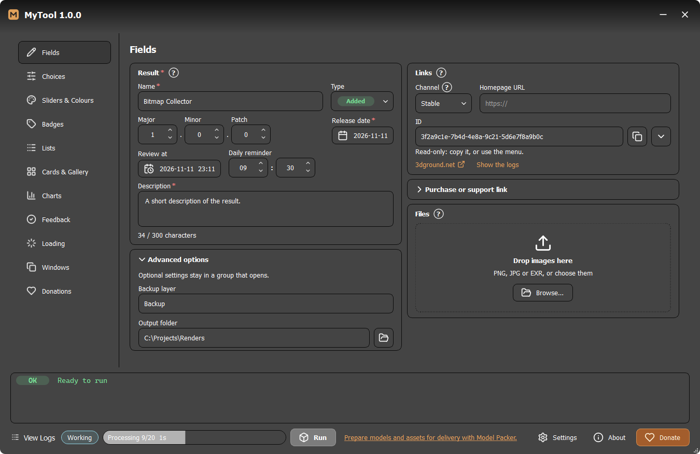

`controls.ProgressBar`: a pill track in `recessed` with a 1 px `border`, fill `accent` at alpha 150 clipped to the
rounded track. Known work: real `done / total`; unknown work: a sweep 30 % wide moving every 40 ms, never invented
percentages. Caption inside: `Label done/total  12s` with elapsed seconds from `time.monotonic()`. The timer runs only
while visible and busy. In the bottom strip it takes the place of the status message while work runs. Results and
errors come back as statuses in the mini log and the state pill.

## Mini log

`statuslog.StatusLog(theme)` inside the main window, in a field frame (`boxed(margin=0)`), a monospaced font (Cascadia
Mono, Consolas, Courier New) at 8.5 pt: **the current state, never a history.** `set_entries([(level, message,
target), ...])` replaces every row on each check: the errors (red) and warnings (yellow), or **one green line** ("Ready
to run", "Package built") when nothing blocks. Nothing piles up, so it has no Clear, Copy or scrolling history; the
history of what happened is in the Logs window. Each row: a level pill of one width (`OK` green, `ERROR` red, `WARN`
yellow, `INFO` blue; fill `<role>_background`, label centred on its capital letters, `paint_pills`), two spaces, the
message in its level's colour; long messages wrap under the message, web addresses stay whole. A row with a target
(a field) is clickable as a whole: on hover it is tinted in its level's colour (alpha 0.12) from one edge of the box to
the other, and a click goes to the field (its tab, its group opened, scrolled into view, focused). Rows have the same
room above and below (`band_span`). Fixed height for about three rows; the state pill shows or hides it.

## Tooltips

Every tooltip of the tool is its own Tip (`controls.Tip`), never Qt's square tooltip: the text on
`tooltip_background` in `tooltip_text`, a 1 px `active_border` outline on every side (`paint_bubble`), radius 6 by a
window mask, Windows' light tooltip shadow (the class inherits `QTipLabel`), at most 360 px wide with word wrap,
padding 4 / 8. It opens 700 ms after the pointer enters a widget (at once while another tip has just closed, so a
row of buttons reads quickly), under the pointer or above it when there is no room, inside the screen's work area,
and goes when the pointer leaves, clicks, scrolls or types, or after 10 s plus 40 ms a character.

How it works, and why: 3ds Max takes every widget's `ToolTip` event at the application level, before the widget's
own event filter sees it, so a tool cannot restyle the tooltip from the event. `controls.own_tooltips` (called by
`unify_heights`) moves each widget's tooltip text into its `toolTipText` property, leaves Qt's tooltip empty (so Max
shows nothing square over ours), sets the accessible description, and watches Enter and Leave. Buttons do it
themselves in `setToolTip`; any other widget whose tooltip changes later uses `controls.set_tip(widget, text)` (a
swatch's colour, a calendar cell, a gallery thumbnail). A chart shows its value with `controls.show_tip(widget,
point, text)` and `hide_tip`. Never round or restyle Qt's own tooltip window: masking it and filtering its events
took 3ds Max 2022 down ([Max reliability](max-reliability.md#qt-objects-that-took-max-down)).

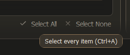

## Help balloons

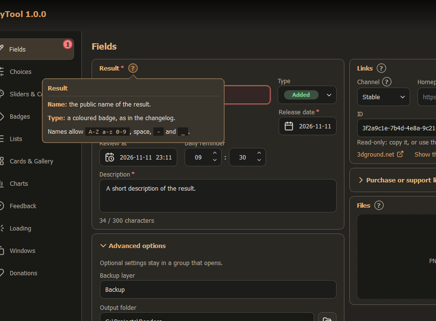

A small round "?" (`controls.HelpButton`, 16 px circle, `muted_text` outline; `accent` outline and a faint accent fill
on hover or while open, bold "?") beside a panel title or a field caption. A click opens a `Balloon`: 300 px wide,
padding 10, radius 6, an arrow of 7 px pointing at the button, `tooltip_background` fill, `active_border` outline; the
bold title in `heading_text`, a thin `border` line 6 px below it, then the help as rich text (`controls.help_html`):

- Blocks separated by a blank line get 7 px between them (`PARAGRAPH_GAP`); a single line break stays a line break.
- `**term**` is bold in `heading_text`; put it at the start of a block ("**Stable**: the release for everyone.").
- `` `code` `` is a small monospaced chip (`field` background, `heading_text`) that never breaks inside (word joiners):
  file names, characters, values.
- `[label](https://...)` is a link in the `link` colour without underline.
- Wrapped lines have a line height of 120 % (`LINE_HEIGHT`); web addresses never break across lines.

It opens below the button when it fits on the screen, else above, and stays inside the work area. A second click on
"?", a click elsewhere or Esc closes it. Shaped by a window mask (no translucent popups inside Max) and outlined on
the whole perimeter, the arrow included: `controls.paint_bubble(painter, shape, fill, border, width)` fills the shape
and strokes it twice as wide, clipped to the shape, so the outline runs along the inside of the same path the mask is
made from. Being a `Qt.Popup` without `NoDropShadowWindowHint`, it casts Windows' light popup shadow along the same
mask, arrow included.

**Writing help:** one idea per block, few words; start a block with the bold term it explains; the reader scans, so no
long paragraphs and no repetition of the visible labels. Three to five short blocks are enough; details belong in
tooltips. Example: "**Name**: the public name of the result. / **Type**: a coloured badge, as in the changelog. / Names
allow `A-Z a-z 0-9`, space, `-` and `_`." The same markup serves How to use steps (`dialogs.how_to_card`).

## Panels, groups, warnings, tabs

- **Panel** (`forms.panel(title, theme, help_title, help_text, required=False)` -> frame, layout): `toolPanel`,
  `tab_pane_background`, 1 px `group_border`, radius 8; inner margins 10 / 6 / 10 / 8, spacing 5; the title row: the
  section title, a red `*` 2 px after it when required, the "?" on the title's centre line. A section block inside
  (`toolPanelSection`): `surface`, `border`, radius 6.
- **Collapsible group** (`forms.Collapsible(title, theme)`, widgets go into `.inner`): drawn as a panel. Its title
  (`GroupHeader`) looks exactly like a panel title (bold, `heading_text`), not like a button: a Lucide
  `chevron-right` / `chevron-down` painted 1 px before the text (`GAP`; the icon has its own air), no background and no
  frame, and on hover only the colour of the text and the arrow changes (to `text`). Margins 6 / 5 / 10 / 5, the same
  above and below, so a closed group is centred; the content is inset by 4 px so it starts where a panel's content
  starts. **Optional groups start closed and open when they hold data** (`set_open(True)`); a jump to a field inside
  a closed group opens it first.
- **Settings group** (`toolSettingsGroup`): `active_tab_background`, `group_border`, radius 6, margins 12 / 8 / 12 / 10,
  a group title, then a form (12 px between label and field, 6 px between rows, labels left).
- **Warning block** (`toolBanner`): a gradient from `log_warning_background` to transparent, 1 px `log_warning`
  border, radius 6, a bold title in `log_warning` and muted text. **Danger block** (`toolDanger`) the same in the error
  colours. Use them for large-result warnings, disclaimers and short-of-disk messages.
- **Tabs**: inside dialogs a `QTabWidget` (tabs radius 6 at the top, padding 6 / 18, 2 px apart; the selected tab has
  the pane's colour and joins the pane, whose top-left corner is square under the first tab). In a main window a
  segmented tab row above a `QStackedWidget` of scroll pages (`forms.scroll_page`).
- **How to use card** (`dialogs.how_to_card(theme, steps, note, title)`): `toolHowTo` (`tab_pane_background`,
  `group_border`, radius 8, margins 14 / 12), a section title, numbered steps 8 px apart, each with a
  `controls.NumberBadge` (20 px circle, accent outline, the digit centred on its own ink, not on the font's line box)
  and the step in help markup; a thin line and a muted note.
- **Tooltips** (Qt's own `QToolTip`): `tooltip_background`, `tooltip_text`, a 1 px `active_border` outline (the help
  balloon's outline colour, so it shows on every side over dark panels; `border` nearly vanished), padding 4 / 6; Qt
  keeps its square corners and the system shadow.

## Small behaviours

- **Copy feedback**: a copy square turns into a green check for 1.4 s with the tooltip "Copied" (`inputs.CopyButton`); a
  text button shows "Copied" for 2000 ms (one restartable single-shot timer), then its caption again.
- **An icon beside a short text sits on its middle.** The status icon of a message, a toast and a welcome point is
  vertically centred on its title and text together (`Qt.AlignVCenter`, the lines 2-3 px apart); a toast's action
  buttons go below, indented to the text, so they never pull the icon down. Never top-aligned beside two lines.
- **The veil lives and dies with its dialog.** It goes when the dialog hides or is destroyed by any path, so a veil
  without a window can never stay. Nothing on the veil can be clicked: a window-modal dialog blocks every input to its
  owner window, the veil included (a close button painted on it did nothing; it was removed).
- **Every resizable window has a size grip** in its bottom-right corner (`QSizeGrip`, 12-16 px): the main window
  and resizable dialogs (Settings, Logs). It hides while the window is collapsed or maximised; the edges resize too.
- **Dialogs open centred** over their owner window: `ToolDialog` lays itself out at its real size after the
  interface-size font and the control height applied, then centres (`centre_on_owner`, inside the work area). Qt's
  own placement happens before that and left dialogs below the middle.
- **ElidedLabel**: one line that elides in the middle instead of widening the layout; full text in the tooltip (the
  status message of the bottom strip).
- **Flash**: after a jump to a field (a click on a mini log row), a rounded highlight in the error colour lights up
  over the field in 0.3 s and fades out within 2 s.
- **Marquee**: one line that scrolls right to left in a loop when it does not fit, pausing 1.5 s each time round.
- **Shimmer**: a soft light band sweeping over a button every few seconds to draw the eye to one action: Run once
  everything is filled in, Donate in the Support window and on the result card. One shimmering button in view at most.
- **FlowLayout**: chips (toggle buttons, pills) that wrap to new rows.
- Timers of animated controls run only while they are visible.

## Lucide icons by action

| Action | Icon | Action | Icon |
| --- | --- | --- | --- |
| Collapse to bar | `minus` | Close | `x` |
| Drag handle | `grip-vertical` | Settings | `settings` |
| Logs | `logs` | About | `info` |
| Donate | `heart` | Refresh, reopen, regenerate | `refresh-cw` |
| Copy | `copy` | Paste | `clipboard-paste` |
| Open folder | `folder-open` | Move to folder | `folder-input` |
| Search | `search` | Add | `plus` |
| Delete, remove | `trash-2` | Clear, erase | `eraser` |
| Show / hide | `eye` / `eye-off` | Layers | `layers` |
| Bookmark / save | `bookmark` / `bookmark-plus` | Download, export | `download` |
| Disk, cache | `hard-drive` | Back | `arrow-left` |
| Run, build | `box` | Stop | `circle-stop` |
| Success | `circle-check` | Error, warning | `circle-alert` |
| Rectangle tool | `square-dashed` | Polygon tool | `pentagon` |
| Locate | `crosshair` / `map-pin` | Link | `link` |
| Edit, rename | `pencil` | Quit | `log-out` |
| Date | `calendar` | Checkbox tick | `check` |
| Dropdown, stepper arrows | `chevron-down` / `chevron-up` | Month, closed group | `chevron-left` / `chevron-right` |
| General settings | `sliders-horizontal` | Appearance, colours | `palette` |
| Reset to defaults | `rotate-ccw` | No more reminders | `bell-off` |
| Welcome, quick start | `sparkles` | Cards, grid view | `layout-grid` |
| Category, tags | `tag` | Favourite, featured | `star` |
| Package, all items | `package` | Online, web | `globe` |
| Offline | `cloud-off` | Zoom, close-up | `zoom-in` |
| Run in a list, start | `play` | Pick a colour from the screen | `pipette` |
| A picture that failed | `image-off` | Pick an object in a viewport | `crosshair` |
| A page outside the tool | `external-link` | Time, now | `clock` |
| Date and time | `calendar-clock` | Drop or import files | `upload` |
| Light | `lightbulb` | Camera | `camera` |
| Charts, statistics | `chart-column` | Loading | `loader` |
| Speed, quality level | `gauge` | | |

Use the original Lucide SVG files (`stroke="currentColor"`, replaced by the role colour when rendering), with the ISC
license in the tool. The Logs icon is Lucide `logs` (rows with dots), not `scroll-text`. No emoji, font symbols or
redrawn paths.
