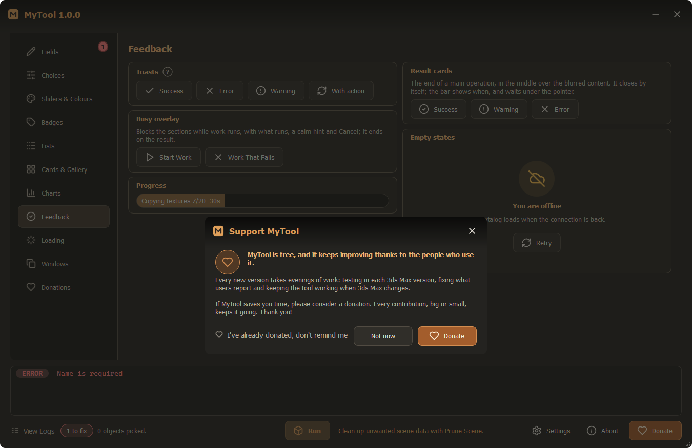
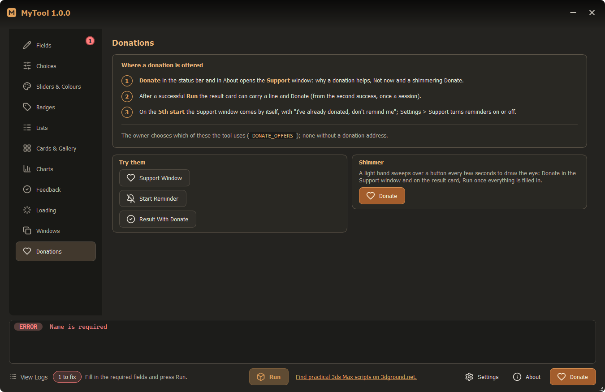

# Donations

A free tool may ask for support, politely and in few places. The starter carries the whole story; the owner chooses
which parts their tool uses. Never invent a donation address, an amount or facts about money: ask the owner.

## Ask the owner first

When a tool is built or changed, ask once: "Do you want donations? Here are the places a donation can be offered:"

| Offer | `DONATE_OFFERS` key | What the user sees | When it suits |
| --- | --- | --- | --- |
| Donate in the status bar | `"status"` | The last button at the right of the status bar, orange with a heart. It opens the Support window, never the page straight away. | Almost every free tool |
| Donate in About | `"about"` | Donate beside Close at the bottom of About (one size); it opens the Support window. | Almost every free tool |
| A line after a success | `"after_success"` | The result card of a finished main operation carries "If MyTool saved you time, a small donation keeps it going." and a shimmering Donate. From the second success on, at most once a session; never after a failure or a cancel. | Tools with a clear main operation (convert, export, build) |
| The start reminder | `"reminder"` | The Support window by itself on the 5th start, then every 30 starts, after the window has settled and only when nothing else is open; never in safe mode. It offers "I've already donated, don't remind me"; Settings > Support has the same switch. | Tools used often, by people who may not open About |

`DONATE_URL = ""` turns every offer off. `DONATE_OFFERS = ()` keeps only the address in Settings > Support. The
numbers are constants in `donation.py` (`REMIND_AT = 5`, `REMIND_EVERY = 30`, `NOTE_FROM = 2`); change them only on the
owner's word.

## The parts

- **Support window** (`dialogs.SupportDialog`, `controller.show_support`): the tool's own window (never a message box),
  a heart on a tinted disc with a ring in the donate colours, the first line of `SUPPORT_TEXT` as its heading, then one
  idea per paragraph in muted text, and "Not now" beside a shimmering Donate, both one size (`controls.same_width`).
  Donate opens `DONATE_URL` in the browser and closes the window. As the reminder it also has the muted "Don't remind
  me again" at the left.
- **SUPPORT_TEXT**: the owner's own words. The starter's text is a neutral placeholder: who the tool is for, what a new
  version costs in work, a thank-you. Keep each paragraph to one or two lines.
- **Result card** (`states.ResultCard.show_message(kind, title, text, ms, donate_note)`): the donation line and Donate
  appear only with `donate_note`; the countdown bar waits while the pointer is on the card, so the user can read it.
  Give it a longer time (9 s) when it carries the line.
- **Shimmer** (`controls.Shimmer`): a light band sweeps over Donate every few seconds in the Support window, on the
  result card and in Settings > Support. Never on the status bar button: one moving thing in view at most.
- **Rules** (`donation.Donations`): pure code, tested without a window. `count_start()` once per start;
  `reminder_due()` / `mark_reminded()`; `after_success()` counts a success and says whether its card may carry the
  line; `set_reminders(on)` for "I've already donated, don't remind me" and the Settings switch. The counters (`starts`, `successes`,
  `donate_reminded_at`) survive Settings > Reset.

## The way out of the reminder

The reminder's only way out is the user's word: "I've already donated, don't remind me" (with a heart; its tooltip
thanks them). Nothing is checked: it is an honour system. Whoever has donated turns the reminders off with a clear
conscience, and whoever has not is asked to say they have, which most people will not do lightly. Settings > Support
has the switch "Remind me about donations now and then (off once you have donated)". Never offer a neutral "Don't
remind me" next to it, and never make the reminder harder to close: "Not now" and Esc always work.

## Rules for every offer

- One click closes it; nothing comes back in the same session.
- Never in the middle of work: no reminder while a job runs or a dialog is open; the line only after the work ended.
- Never blocks the tool: "Not now" and Esc always work; the user can do everything without donating.
- Never on a failure, a cancel or a warning.
- The same donate colours everywhere (orange background, light border); the heart icon.
- The address is the owner's; a test never opens it (the trainer's checks only show the windows).

## In the trainer

The Donations section explains every offer and shows them: Support Window, Start Reminder, Result With Donate, and a
Donate with its shimmer. Run in the status bar shows the real line on its second success.
