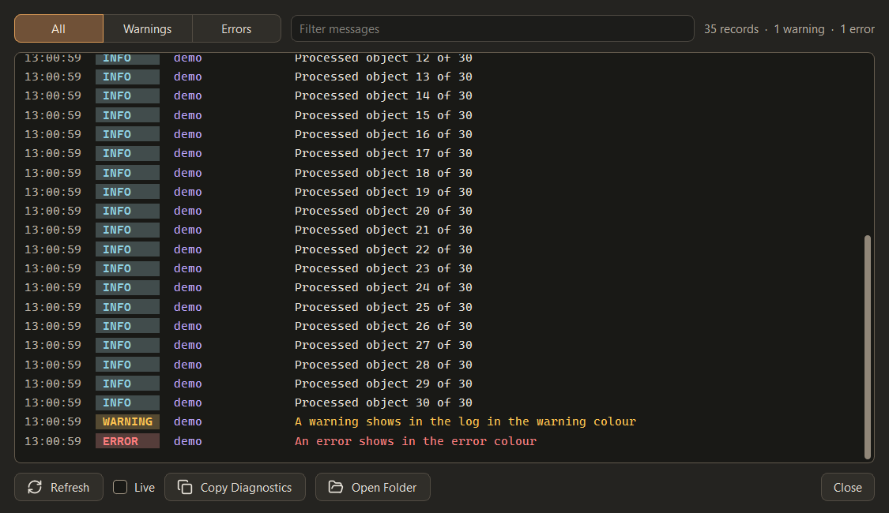
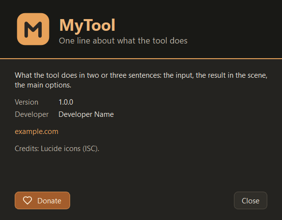

# Settings, Logs, About and Donate

Every tool made with this skill has Settings, Logs and About buttons in its status bar, and Donate buttons when the
owner gave a donation destination. Implementation: [dialogs](templates/dialogs.md), [tool window](templates/tool-window.md).
All three are modal tool dialogs with a native frame and a veil over the main window ([windows](window-chrome.md)).

## Settings

- Title "Name Settings", about 520 x 460 (scaled), margins 16, spacing 8.
- A `QTabWidget`; the first tab is **General**. Tool-specific tabs come after it (for example "API keys": keys are
  optional extras, the tool works without them, and the tab says so).
- Each tab holds titled groups (`settings_group`): a rounded block with a bold title and a form below it.
- The first group is **Appearance**:
  - **Theme**: a dropdown of the shipped palettes by display name; selecting one applies it to every tool window,
    popup and painted control at once. A palette that cannot be loaded leaves the previous theme active, the picker goes
    back to it and an error line explains; a theme applied but not saved says "applied but not saved".
  - **Interface size**: "Auto (125%)" (the measured value in brackets), then 100 % to 200 %. Changing it shows
    "Applies when Name opens again." with a "Reopen Now" button (`refresh-cw`) inside Max.
- Then the tool's own groups (options, cache folder with "Manage Cache...", output formats, ...). Each control has a
  tooltip that says what it does and what it costs.
- Values are saved when changed (no OK / Apply); a Close button at the bottom right.
- A failed settings write is reported ("Settings could not be saved: ...") in the status bar, never ignored.

## Logs

- A log file per Max version (`<name>-max2027.log`, rotating), written by the tool's own logger with
  `propagate = False`: the Listener stays clean, and nothing is shown unless the user clicks Logs. No milliseconds in
  timestamps.
- Window "Name Log", about 900 x 520. Top row: a segmented filter **All / Warnings / Errors**, a filter field
  ("Filter messages", clear button) and a summary "35 records · 1 warning · 1 error".
- The view: a read-only text view in a monospace font (Cascadia Mono, then Consolas, then the system fixed font) at 9 pt
  scaled, no wrapping, line height 135 %, `recessed` background. Day headers, a bold accent line at each session start
  ("Session started 12:53:26 1.0.0 from ..."), then per record: time (muted), the level as a coloured badge (INFO /
  WARNING / ERROR with the palette's log colours and backgrounds), the source (`log_system`), the message (warnings and
  errors in their colour, successful steps such as "Started" in `log_success`).
- Bottom row: Refresh (`refresh-cw`), a **Live** checkbox (refresh every 2 s while open), **Copy Diagnostics** (`copy`:
  tool / Max / Python / Qt / OS versions plus the last 64 KB of the log; the caption shows "Copied" for 2 s), **Open
  Folder** (`folder-open`), and Close on the right.
- The view keeps the end in sight when it was at the end; the file stays plain text.

## About

- Width 460 (scaled), height fitted to the content (at most 90 % of the work area), body scrolls if needed.
- **Hero** (fixed height, `recessed` background, margins 24 / 18, spacing 12): the brand icon 60 px, the name in
  `heading_text` bold 20 pt and a one-line subtitle in muted 10 pt right under it.
- A full-width 2 px **accent divider**.
- **Body** (margins 24 / 18, spacing 12): two or three sentences of description; a small grid Version / Developer (muted
  labels, selectable values); links in the link colour without underline; an optional **disclaimer** in the warning
  block (third-party data, unofficial sources, who is responsible); credits in muted text (Lucide icons (ISC) and every
  bundled program or library with its license).
- A 36 px gap, then **Donate** at the left (when there is a destination) and **Close** at the right.
- Values that are not known are left out (no "Developer: TBD", no invented website).

## Donate

- Appears only when the owner gave a destination (`DONATE_URL`); otherwise no Donate button exists anywhere.
- Look: the `donate` button variant (`donate_background`, `donate_border`, `status_button_text`, hover `donate_hover`)
  with the Lucide `heart` icon and the text "Donate"; tooltip "Support Name development".
- Places: the **last button on the right of the status bar**; the **left of About's bottom row**; optionally on a
  completion card or a long-running work view (next to Cancel or the result actions). Nowhere else, never in a modal
  question, never animated or blinking.
- A click opens the destination in the browser (`QDesktopServices.openUrl`). Never send data, never open it on its own.

## Help balloons beside section titles

Each panel section and group title can carry a round "?" that opens a balloon with a bold title and two or three plain
sentences: what this part does, what the main choices mean, what costs time. Keep detailed per-control explanations in
tooltips. See [controls catalog](controls-catalog.md) for the look.
