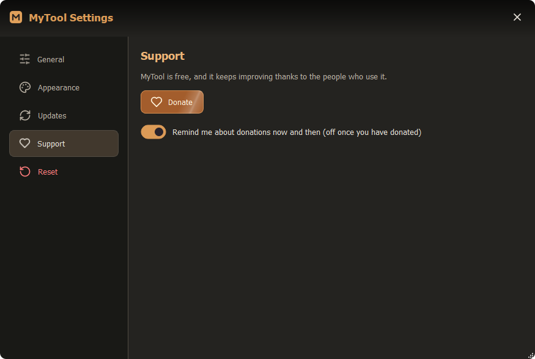
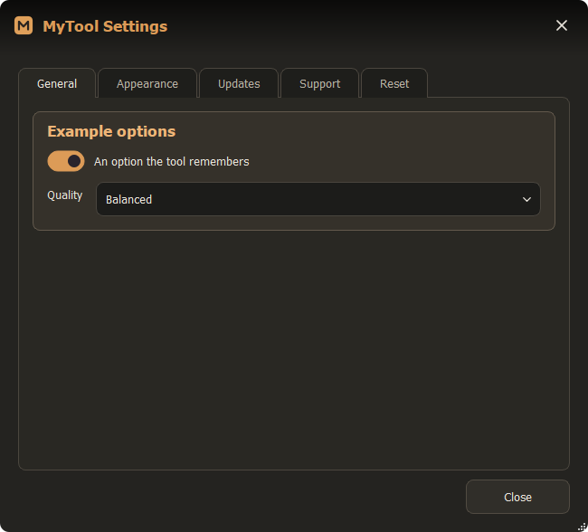
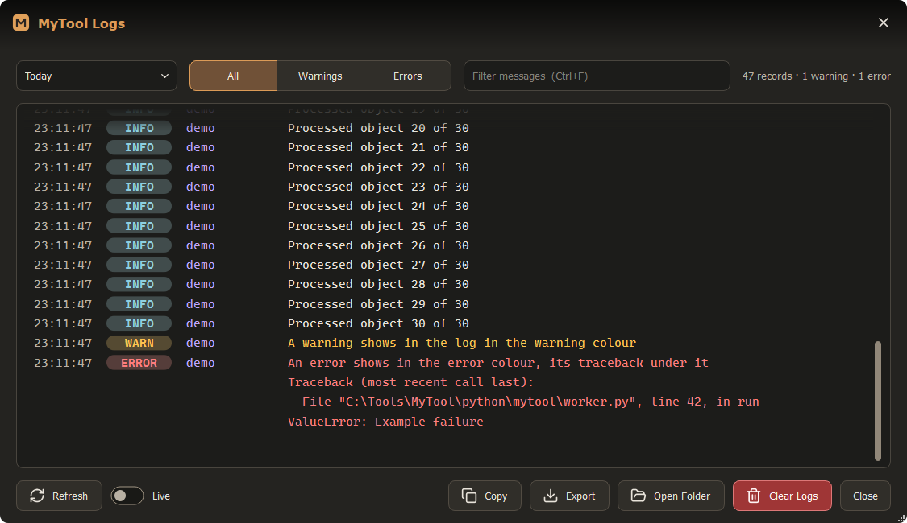
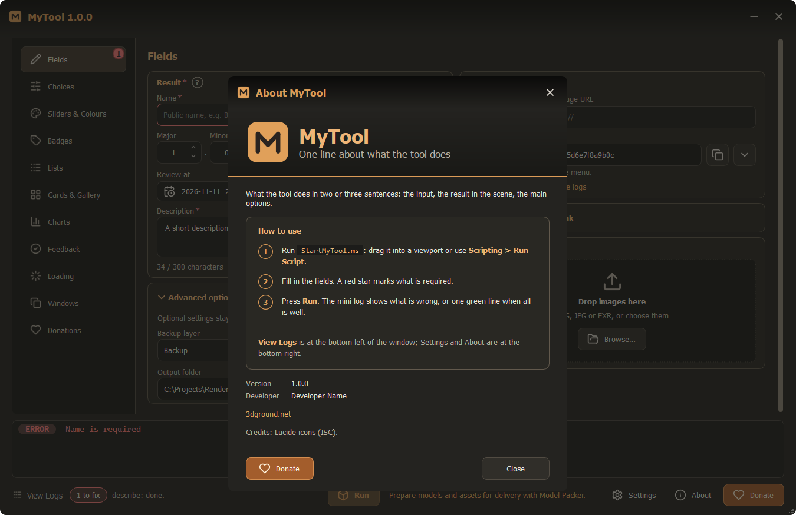
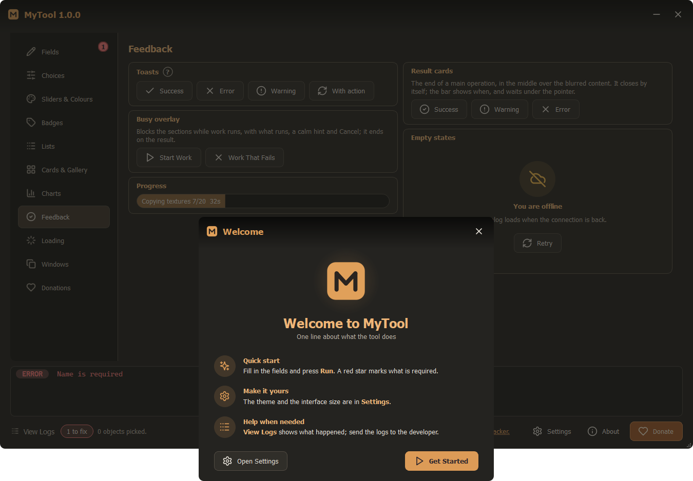
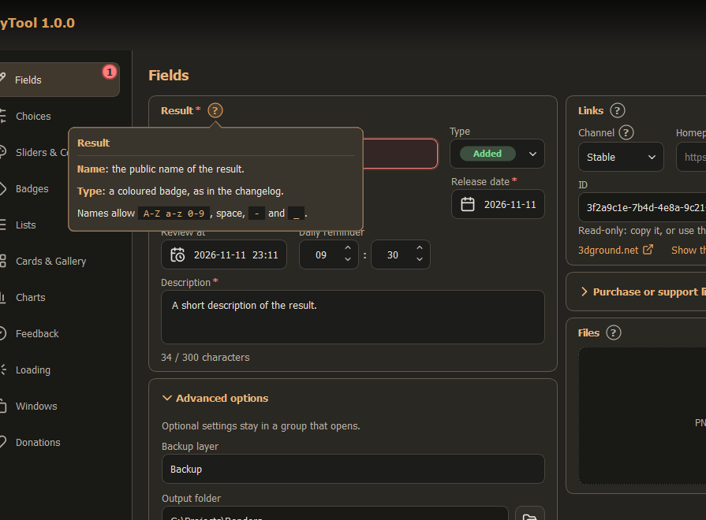

# Settings, Logs, About and Donate

Every tool made with this skill has Settings, Logs and About buttons in its status bar, and Donate buttons when the
owner gave a donation destination. Implementation: [dialogs](templates/dialogs.md), [logs](templates/logs.md),
[tool window](templates/tool-window.md). All three have the main window's own chrome: title bar with the icon, the
title and a round close button, and the header shade ([windows](window-chrome.md)); Settings and About are modal and
veil the main window, the Logs window is not modal. The Logs window opens from **View Logs** at the left of the status
bar; Settings and About are on its right.

## Settings

`dialogs.SettingsDialog` builds its sections from `SECTIONS` (key, title, Lucide icon) with a `_build_<key>` method
each, in a `sections.SectionBook`: **tabs on top for up to three sections, a list on the left from four** (the MaxPkg
Package Manager's Settings), or the style a tool passes (`SettingsDialog(controller, parent, side=True)`). The
starter's sections: General (the tool's own options), Appearance (theme, interface size), Updates (only with an
`UPDATE_URL`), Support (only with a `DONATE_URL`: the first line of `SUPPORT_TEXT`, a shimmering Donate and the
reminder switch) and Reset in red (every setting back to its default after a question; the donation counters stay).
In the list style the close button is in the title bar (and Esc); in the tab style Close sits at the bottom right.
Every change saves at once.

- Title "Name Settings"; tabs about 520 x 470, the list about 700 x 470 (scaled), resizable with a size grip.
- **General** holds the tool's own options in titled groups (`settings_group`: a rounded block with a bold title and
  a form). On / off options are switches; each control has a tooltip that says what it does and what it costs.
  Tool-specific sections come after it (for example "API keys": optional extras, the section says so).
- **Appearance**:
  - **Theme**: a dropdown of the shipped palettes by display name; selecting one applies it to every tool window,
    popup and painted control at once. A palette that cannot be loaded leaves the previous theme active, the picker goes
    back to it and an error line explains; a theme applied but not saved says "applied but not saved".
  - **Interface size**: "Auto (125%)" (the measured value in brackets), then 100 % to 200 %. Changing it shows
    "Applies when Name opens again." with a "Reopen Now" button (`refresh-cw`) inside Max.
- **Updates** (only when the tool has an `UPDATE_URL`, see [updates](updates.md)): a switch "Check for updates
  automatically and install them in the background" and **Check Now** with a line that says the result.
- **Support** (only with a `DONATE_URL`, see [donations](donations.md)).
- **Reset** (red): "Reset Settings" asks first, then puts every setting back and offers Reopen Now in a toast.
- Values are saved when changed (no OK / Apply).
- A failed settings write is reported ("Settings could not be saved: ...") in the status bar, never ignored.

## Logs

- **One log file per day**: `logs/<name>-YYYY-MM-DD.log` in the tool's user data folder, written by the tool's own
  logger with `propagate = False` (the Listener stays clean; nothing is shown unless the user clicks Logs). Each record
  is appended and the file is closed again at once (`DailyFileHandler`): no file stays open, so Clear Logs can delete
  every day and two 3ds Max versions can write the same day's file. Files older than 60 days are removed when the tool
  starts. No milliseconds in timestamps. The faulthandler crash log stays a separate file per Max version.
- Window "Name Logs", about 900 x 520, **not modal** and resizable (a size grip in the corner): the tool stays usable
  and Live shows what it writes. It opens from **View Logs**, the text action at the left of the status bar. Top row: a
  **day picker** (`Today`, `Yesterday`, then `Thu 29 Oct 2026`, English whatever the Windows language; "No logs yet"
  when there is none), the segmented filter **All / Warnings / Errors**, a search field ("Filter messages (Ctrl+F)",
  clear button) and a summary "35 records · 1 warning · 1 error" (warnings and errors only when there are any).
- The view: read-only, in a field frame, a monospaced font (Cascadia Mono, then Consolas, then Courier New) at 9 pt
  scaled, line height 135 %, no horizontal scrolling: long messages and tracebacks wrap under the message column, not
  under the time. A bold accent line at each session start ("Session started 12:53:26 · 1.0.0 from ..."), then per
  record: time (muted), the level as a rounded pill of one width with its label centred (`INFO`, `WARN`, `ERROR`,
  `DEBUG` with the palette's log colours and backgrounds; `statuslog.paint_pills`), the source (`log_system`), the
  message (warnings and errors in their colour, successful steps such as "Started" in `log_success`).
- **Whole records are selected**, never characters: a click, Shift, Ctrl or a drag; one rounded accent band (alpha
  0.22) per run of selected records with the same room above and below. Esc clears the selection, then closes.
- Bottom row: **Refresh** (`refresh-cw`, F5), a **Live** switch (new records and a new day every 2 s while open), then
  on the right **Copy** (`copy`: the selected records, or every shown one, Ctrl+C), **Export** (`download`: the shown
  records to a text file, Ctrl+E), **Open Folder** (`folder-open`), **Clear Logs** (`trash-2`, danger) and Close.
  Copy and Export show "Copied" / "Exported" for 2 s. Clear Logs asks first in the tool's own question window
  (`dialogs.ask`: "Clear all logs?", the number of days and the size, "This cannot be undone.", Cancel as the default
  button, Clear Logs in red) and then shows the empty state; a file another Max is writing at that moment is kept and
  said so.
- The context menu repeats the actions with their shortcuts (Search, Copy Selected / Copy All Shown, Select All,
  Export, Copy Diagnostics, Go to Latest) and puts **Clear Logs...** last, in red. **Copy Diagnostics** copies tool /
  Max / Python / Qt / OS versions plus the last 64 KB of today's log.
- The view keeps the end in sight when it was at the end; the selection survives a refresh; the file stays plain text.

### The mini log inside the main window

The main window's mini log ([controls catalog](controls-catalog.md#mini-log)) shows **statuses only**: the current
errors and warnings, or one green line when nothing blocks. It is rebuilt on every check and never keeps a history;
what happened (steps, paths, timings) goes to the log file and the Logs window.

## About

- Width 460 (scaled), height fitted to the content (at most 90 % of the work area), body scrolls if needed.
- **Hero** (fixed height, `recessed` background, margins 24 / 18, spacing 12): the brand icon 60 px, the name in
  `heading_text` bold 20 pt and a one-line subtitle in muted 10 pt right under it.
- A full-width 2 px **accent divider**.
- **Body** (margins 24 / 18, spacing 12, scrolls when needed): two or three sentences of description; an optional
  **How to use** card (`how_to_card`: numbered steps in help markup, a line and a note; `USE_STEPS` empty leaves it
  out); a small grid Version / Developer (muted
  labels, selectable values); links in the link colour without underline; an optional **disclaimer** in the warning
  block (third-party data, unofficial sources, who is responsible); credits in muted text (Lucide icons (ISC) and every
  bundled program or library with its license).
- A footer outside the scrolling body (margins 24 / 10 / 24 / 14), always in view: **Donate** at the left (when there
  is a destination) and **Close** at the right. The height fits the content once after the first layout pass (rich
  text measures taller at its real width), within 90 % of the work area.
- Values that are not known are left out (no "Developer: TBD", no invented website).

## Welcome

On the first start (`starts == 1`, never in safe mode) the welcome window opens once the main window has settled:
the brand icon centred on a soft glow with "Welcome to Name" and the subtitle centred below (deliberately unlike
About: no hero plate, no accent line), three points from `WELCOME_POINTS` and Open Settings / Get Started.

`WELCOME_POINTS = ()` turns it off.

## Donate

Donate buttons open the Support window first; the whole story (status bar, About, the line after a success, the start
reminder, Settings > Support) and the rule to ask the owner are in [donations](donations.md).

- Appears only when the owner gave a destination (`DONATE_URL`) and only in the offers they chose (`DONATE_OFFERS`);
  otherwise no Donate button exists anywhere.
- Look: the `donate` button variant (`donate_background`, `donate_border`, `status_button_text`, hover `donate_hover`)
  with the Lucide `heart` icon and the text "Donate"; tooltip "Why a donation helps Name".
- Places: the **last button on the right of the status bar**; the **left of About's bottom row**, one size with Close;
  the Support window; the result card after a success; Settings > Support. Never in a question or an error.
- Movement: only the slow shimmer on Donate in the Support window, on the result card and in Settings > Support; the
  status bar button stays still. Nothing blinks.
- The page opens in the browser (`QDesktopServices.openUrl`) only from a Donate in the Support window, on the result
  card or in Settings. Never send data, never open it on its own.

## Help balloons beside section titles

Each panel title, group title or field caption can carry a round "?" that opens a balloon: a bold title, a thin line,
then short blocks in help markup (`**term**`, `` `code` ``, links): what this part does, what the main choices mean,
what costs time. One idea per block, few words. Keep detailed per-control explanations in tooltips. See
[controls catalog](controls-catalog.md#help-balloons) for the look and the writing rule.
