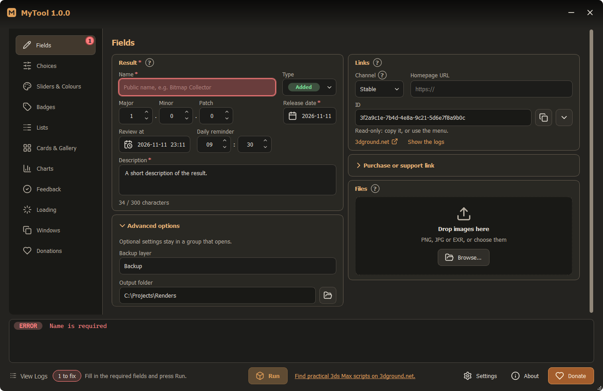

# Starter templates

A complete, verified starting project for a new tool. Every page in `templates/` holds the full text of one or more
modules; together they make a tool that starts from a `.ms` launcher, restarts cleanly, has the standard window,
controls, Settings / Logs / About / Donate, themes, interface size, a start guard and Max-safe background jobs. Start
new tools from these files instead of writing the same infrastructure again; then replace the example content.

The starter was assembled from TerraScoop (a free Python + Qt tool for 3ds Max 2022-2027 by the same author) and run as
one project outside Max with Max 2022's Python 3.7.9 / PySide2 5.15.1 and Max 2027's Python 3.13.9 / PySide6 6.8.3:
window, help balloon, background job with progress, Settings, About, Logs, collapse and restore, close. The parts were
host-tested inside Max 2022 and 2027 as part of TerraScoop; the assembled starter itself was not run inside Max while
this skill was prepared. Test the generated tool in the host as [testing](testing.md) describes.

Version 1.2.0 adds the interface components approved in MaxPkg Packager 2.0 (a Python + Qt tool for 3ds Max 2022-2027
by the same author): the header shade, required marks and the error bubble, help balloons with markup, collapsible
groups, switches, steppers, the date picker, the badge dropdown, one control height, rounded menus and popups, round
window buttons and a compact collapsed bar, the daily logs with the new Logs window and the mini log. The example main
window now shows every control in one design on three tabs; every window has the main window's chrome, questions
replace message boxes, View Logs sits at the left of the status bar and toasts come from MaxPkg Runtime Manager. The
starter was assembled again and checked inside 3ds Max 2022 and 2027 through Max Ultra MCP (see
[evidence](evidence.md)).

The example main window is now a controls trainer: eleven sections in a list on the left (Fields, Choices, Sliders
& Colours, Badges, Lists, Cards & Gallery, Charts, Feedback, Loading, Windows, Donations) show every component in one
design, including the calendar with months, years and a time, dropdowns with icons, groups, typing and check boxes,
choice cards, sliders, colour pickers, count and status badges, tags, filter pills, search with suggestions, the list
editor, a scene tree, a drop zone, cards, a gallery, stat tiles and charts, spinners, skeleton rows, a progress ring,
wizard steps, the busy overlay, result cards, empty states, soft edges on scrolling areas, the tool's own messages and
prompts, Settings as tabs or as a list, the welcome window and every donation offer ([donations](donations.md)). Every
margin and gap is on one spacing scale. It is a gallery to choose from, not a layout to copy.

Version 1.3.0 adds the confetti burst approved in MaxPkg Packager's installer (`ui/confetti.py`): the result card
bursts from its success sign with `celebrate=True`, and the trainer's Feedback section plays it from **Success With
Confetti** and **Burst From Here**. It also adds the Before / After compare slider of the MaxPkg Package Manager
(`gallery.CompareSlider`), shown in the trainer's Cards & Gallery section. Both were checked inside 3ds Max 2022 and
2027 (see [evidence](evidence.md)).

## Files

| Template page | Target files | What it gives |
| --- | --- | --- |
| [launcher-bootstrap](templates/launcher-bootstrap.md) | `StartMyTool.ms`, `python/bootstrap.py` | Thin launcher (it also defines `MyToolAPI`); one session, clean restart polled on a Qt timer |
| [api](templates/api.md) | `MyToolAPI.ms`, `python/api_entry.py`, `python/mytool/api.py`, `python/mytool/max_api.py` | The tool without its window: operations for MAXScript, Python and AI assistants; scene work on the main thread only |
| [package-basics](templates/package-basics.md) | `python/mytool/__init__.py`, `settings.py`, `donation.py`, `resources.py` | Identity (name, version, developer, links, donation URL and offers), JSON settings with test overrides, when a donation is offered, package paths |
| [qt-compat](templates/qt-compat.md) | `python/mytool/qt_compat.py` | PySide2 / PySide6, screens by position, work areas, active viewport, DWM corners, Max hotkeys, safe mode |
| [ui-scale](templates/ui-scale.md) | `python/mytool/ui_scale.py` | Interface size for 2K / 4K screens: `px()`, `pt()`, the spacing scale `space()`, scaled style sheet |
| [themes-style](templates/themes-style.md) | `themes.py`, `ui/theme_manager.py`, `ui/style.qss` | Palette resolution, transactional theme switch, the canonical style sheet |
| [logs](templates/logs.md) | `python/mytool/logs.py`, `ui/statuslog.py`, `ui/logwindow.py` | One log file per day, crash log, record parsing; the Logs window; the mini log (statuses only) |
| [controller-workers](templates/controller-workers.md) | `controller.py`, `workers.py` | Session owner, cleanup ledger, main-thread poster, GIL pump, GC hold, job runner |
| [startguard-gcprobe](templates/startguard-gcprobe.md) | `startguard.py`, `gcprobe.py` | Crash-at-start detection, safe mode, Listener report, collector probe |
| [controls](templates/controls.md) | `ui/controls.py`, `ui/toast.py` | Every shared control: one height and one footer width, buttons, window buttons, the View Logs status action, menus with keys and a red Delete, text fields' menus in the tool's look, field frames, error bubble, flash, pills, progress, segments, dropdown, help balloons, shimmer, soft scroll edges; toasts with animated status icons |
| [forms](templates/forms.md) | `ui/forms.py`, `ui/switch.py`, `ui/pickers.py` | Panels with required star and help, captions, collapsible groups, badge dropdown, switch, stepper, time field, date picker with months, years and an optional time |
| [tool-window](templates/tool-window.md) | `ui/tool_window.py` | Title bar with round buttons, header shade, edges, rounded corners, compact collapsed bar that follows Max, status bar |
| [updates](templates/updates.md) | `python/mytool/updater.py`, `tools/release.py` | Optional self-update: verified install into the user profile, rollback, the release script |
| [sections-inputs](templates/sections-inputs.md) | `ui/sections.py`, `ui/inputs.py` | Sections as tabs or as a list on the left; search with suggestions, copy button, clearable filter, pick button, multi-select list, list editor |
| [sliders-colors-badges](templates/sliders-colors-badges.md) | `ui/sliders.py`, `ui/colors.py`, `ui/badges.py` | One- and two-handle sliders, colour picker, count and status badges, tags, status dots, filter pills |
| [cards-states](templates/cards-states.md) | `ui/cards.py`, `ui/gallery.py`, `ui/states.py`, `ui/confetti.py` | Cards in a responsive grid; the gallery and its lightbox; the Before / After slider; busy overlay, result card with the donation line, empty state, the empty state in the list's own place; the confetti burst from the result card's success sign |
| [combos-tree](templates/combos-tree.md) | `ui/combos.py`, `ui/tree.py` | Dropdowns with icons, groups, typing and check boxes; choice cards; the scene tree; the drop zone |
| [charts-loading](templates/charts-loading.md) | `ui/charts.py`, `ui/loading.py` | Stat tiles, column, line and donut charts with hover values; spinners, the busy button, skeleton rows, the progress ring, wizard steps |
| [dialogs](templates/dialogs.md) | `ui/dialogs.py` | Every window's frameless chrome (`ToolDialog`), veil, Settings in sections (tabs or a list), About, Welcome, Support, questions, messages and prompts (`ask`, `inform`, `ask_text`) |
| [main-window-example](templates/main-window-example.md) | `ui/main_window.py` | The controls trainer: eleven sections in a list on the left, mini log, primary action, background job, result card |

Assets the project needs besides the code:

- `assets/themes/*.json`: the seven [palettes](palettes.md) (copy them byte for byte; `graphite` is the default).
- `assets/icons/*.svg`: original [Lucide](https://lucide.dev) icons with `stroke="currentColor"`, plus `LICENSE-lucide.txt`
  (ISC). The starter uses: `bell-off`, `box`, `calendar`, `calendar-clock`, `camera`, `chart-column`, `check`,
  `chevron-down`, `chevron-left`, `chevron-right`, `chevron-up`, `chevrons-left-right`, `circle-alert`, `circle-check`, `clipboard-paste`,
  `clock`, `cloud-off`, `copy`, `crosshair`, `download`, `external-link`, `eye`, `eye-off`, `folder-open`, `gauge`,
  `globe`, `grip-vertical`, `heart`, `image-off`, `info`, `layers`, `layout-grid`, `lightbulb`, `loader`, `logs`,
  `minus`, `package`, `palette`, `pencil`, `pipette`, `play`, `plus`, `refresh-cw`, `rotate-ccw`, `scroll-text`,
  `search`, `settings`, `sliders-horizontal`, `sparkles`, `star`, `tag`, `trash-2`, `upload`, `x`, `zoom-in`. A real tool keeps only the icons it uses; see the icon table in
  [controls catalog](controls-catalog.md).
- `assets/<tool>.svg`: the tool's own square brand icon (title bar, collapsed bar, About). Not a Lucide icon.

## Make it the tool

1. Choose the package id (lower case, unique, e.g. `scenecheck`) and the display name (e.g. `SceneCheck`). Replace
   `mytool` with the id and `MyTool` with the name in every file, including `_mytool_session` (the restart anchor),
   the launcher file name `StartMyTool.ms` and the brand icon `assets/mytool.svg`.
2. Optionally replace the object-name prefix `tool` (`#toolWindow`, `"toolPanel"`) with a short prefix of the tool in
   both `style.qss` and the Python files, so two tools' style sheets can never collide.
3. Fill `__init__.py`: `__version__`, `SUBTITLE`, `DEVELOPER`, `LINKS`, `DONATE_URL`, `DONATE_OFFERS` and the rotating
   link's `PROMOTIONS` (the owner's own sites and tools; `()` for none). Leave unknown values empty; About
   and the Donate buttons leave out what is empty. Never invent a developer name, link or payment destination.
4. Replace `ui/main_window.py`'s example content with the tool's panels, in one column about as wide as the
   Command Panel (300-360 px at 100 %) unless the content needs width. Keep: one rounded panel per area
   (`forms.panel`), titles and captions with a red `*` where the validation requires them, "?" help balloons in short
   blocks, optional groups closed (`forms.Collapsible`), switches for on / off options, the primary action pinned at
   the bottom (never inside a scroll area), statuses in pills and the mini log, `controls.unify_heights` after
   building and when shown, `ErrorHints` on every validated field.
5. Add the tool's settings keys to `settings.DEFAULTS` (one type per key) and its sections to
   `SettingsDialog.SECTIONS` with a `_build_<key>` method each (tabs up to three sections, a list on the left from
   four). Ask the owner which donation offers they want (`DONATE_OFFERS`, [donations](donations.md)) and write
   `SUPPORT_TEXT` in their words; `WELCOME_POINTS` say what the tool is for, or `()` for no welcome window.
6. Put scene work in `max_api.py` (main thread, pymxs only there) and heavy pure work in jobs through
   `controller.run_job` or a child process (see [Max reliability](max-reliability.md)). Give every operation of the
   window an entry in `api.py`'s `OPERATIONS` (purpose, `changes_scene`, checked parameters, an example, `dry_run`
   for scene changes) and let the window call it: the [API](api.md) is part of every tool, not an extra.
7. Keep the Python 3.7 floor if Max 2022 is supported; compile every module with the oldest and newest target Python.
8. Run the interface harness inside each available Max and the host checks in [testing](testing.md), then package as [MaxPkg delivery](maxpkg-delivery.md)
   describes. New runtime files must be added to the packager's explicit file list.

## What not to change without a reason

These details each fixed a real failure in Max; [Max reliability](max-reliability.md) has the history:

- `qt_compat.live_screens` / `screen_at` / `work_area` instead of `widget.screen()`.
- `qt_compat.repolish` instead of `style().unpolish/polish` (it also keeps the widget's interface-size font).
- The `_GilPump` around every background job, and `JobRunner.submit` as the only way to start one.
- `hold_gc` for PySide2 on Python 3.10+ (3ds Max 2024) and after any crash marked "Garbage-collecting".
- The start guard steps and the report printed to the Listener.
- `inherit_fonts` after polish (`showEvent`, `ComboBox.showPopup`) and after building rows later.
- Dialog window flags set explicitly (`Qt.Dialog | WindowTitleHint | WindowSystemMenuHint | WindowCloseButtonHint`).
- No signals on the object registered with `QWebChannel` (if the tool adds a web view).
- `inherit_fonts` after a theme's `setStyleSheet` (`ThemeManager._apply`): the new sheet re-polishes every widget and
  some get the default font back (fields at 9 pt after a theme change at 125 %).
- No attribute named `font` on a widget (`self.font = ...` hides `QWidget.font()`; `inherit_fonts` then fails at any
  interface size other than 100 %): the mini log and the Logs window use `mono_font`.
- `Menu.fit_fonts()` before a menu is measured, and a popup's font set from its window.
- The style property `compact` (not `size`) for the collapsed bar's small close button.
- `ErrorHints` waits for real pointer movement before the bubble; a test fakes the pointer through `cursor_pos`.
- `unify_heights` again in `showEvent`: style-sheet sizes apply at first show.
- A search completer belongs to the window (`SearchBox(owner=window)`), its list is created and handed over with
  `setPopup`: a completer that was a child of its own line edit took 3ds Max 2022 down (heap corruption) as soon as
  the trainer window showed.
- `getattr` for a subclass's widgets inside `eventFilter`, and a watched widget assigned before `installEventFilter`:
  PySide6 calls the filter from the base constructor already (the Support and message windows did not open in 3ds
  Max 2027).
- A validator, model or delegate set on a widget gets a Qt parent: one held only by Python is deleted while the
  widget still uses it.
- `ToolDialog.centre_on_owner` after the first show's font and height changes: Qt's own placement comes earlier.
- `Button.setText` doubles a plain `&`: Qt would read "Cards & Gallery" as a shortcut letter and drop the `&`.
