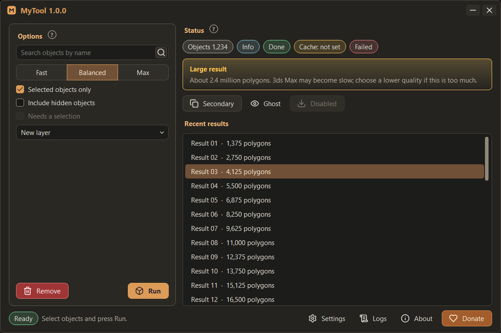

# Starter templates

A complete, verified starting project for a new tool. Every page in `templates/` holds the full text of one or more
modules; together they make a tool that starts from a `.ms` launcher, restarts cleanly, has the standard window,
controls, Settings / Logs / About / Donate, themes, interface size, a start guard and Max-safe background jobs. Start
new tools from these files instead of writing the same infrastructure again; then replace the example content.

The starter was assembled from TerraScoop (a free Python + Qt tool for 3ds Max 2022-2027 by the same author) and run as
one project outside Max with Max 2022's Python 3.7.9 / PySide2 5.15.1 and Max 2027's Python 3.13.9 / PySide6 6.8.3:
window, help balloon, background job with progress, Settings, About, Logs, collapse and restore, close. The parts were
host-tested inside Max 2022 and 2027 as part of TerraScoop; the assembled starter itself was not run inside Max while
this skill was prepared. Test the generated tool in the host as [testing](testing.md) describes.

## Files

| Template page | Target files | What it gives |
| --- | --- | --- |
| [launcher-bootstrap](templates/launcher-bootstrap.md) | `StartMyTool.ms`, `python/bootstrap.py` | Thin launcher; one session, clean restart polled on a Qt timer |
| [package-basics](templates/package-basics.md) | `python/mytool/__init__.py`, `settings.py`, `resources.py` | Identity (name, version, developer, links, donation URL), JSON settings with test overrides, package paths |
| [qt-compat](templates/qt-compat.md) | `python/mytool/qt_compat.py` | PySide2 / PySide6, screens by position, work areas, active viewport, DWM corners, Max hotkeys, safe mode |
| [ui-scale](templates/ui-scale.md) | `python/mytool/ui_scale.py` | Interface size for 2K / 4K screens: `px()`, `pt()`, scaled style sheet |
| [themes-style](templates/themes-style.md) | `themes.py`, `ui/theme_manager.py`, `ui/style.qss` | Palette resolution, transactional theme switch, the canonical style sheet |
| [logs](templates/logs.md) | `python/mytool/logs.py` | Rotating log per Max version, crash log, log view parsing |
| [controller-workers](templates/controller-workers.md) | `controller.py`, `workers.py` | Session owner, cleanup ledger, main-thread poster, GIL pump, GC hold, job runner |
| [startguard-gcprobe](templates/startguard-gcprobe.md) | `startguard.py`, `gcprobe.py` | Crash-at-start detection, safe mode, Listener report, collector probe |
| [controls](templates/controls.md) | `ui/controls.py` | Every shared control |
| [tool-window](templates/tool-window.md) | `ui/tool_window.py` | Title bar, edges, rounded corners, collapsed bar that follows Max, status bar |
| [dialogs](templates/dialogs.md) | `ui/dialogs.py` | Veil, Settings, Logs, About |
| [main-window-example](templates/main-window-example.md) | `ui/main_window.py` | Example content using every control |

Assets the project needs besides the code:

- `assets/themes/*.json`: the seven [palettes](palettes.md) (copy them byte for byte; `graphite` is the default).
- `assets/icons/*.svg`: original [Lucide](https://lucide.dev) icons with `stroke="currentColor"`, plus `LICENSE-lucide.txt`
  (ISC). The starter uses: `box`, `check`, `chevron-down`, `copy`, `download`, `eye`, `folder-open`, `grip-vertical`,
  `heart`, `info`, `minus`, `refresh-cw`, `scroll-text`, `search`, `settings`, `trash-2`, `x`. Add any icon the tool
  uses; see the icon table in [controls catalog](controls-catalog.md).
- `assets/<tool>.svg`: the tool's own square brand icon (title bar, collapsed bar, About). Not a Lucide icon.

## Make it the tool

1. Choose the package id (lower case, unique, e.g. `scenecheck`) and the display name (e.g. `SceneCheck`). Replace
   `mytool` with the id and `MyTool` with the name in every file, including `_mytool_session` (the restart anchor),
   the launcher file name `StartMyTool.ms` and the brand icon `assets/mytool.svg`.
2. Optionally replace the object-name prefix `tool` (`#toolWindow`, `"toolPanel"`) with a short prefix of the tool in
   both `style.qss` and the Python files, so two tools' style sheets can never collide.
3. Fill `__init__.py`: `__version__`, `SUBTITLE`, `DEVELOPER`, `LINKS`, `DONATE_URL`. Leave unknown values empty; About
   and the Donate buttons leave out what is empty. Never invent a developer name, link or payment destination.
4. Replace `ui/main_window.py`'s example content with the tool's panels. Keep: one rounded panel per area, section titles
   with a "?" help balloon, the primary action pinned at the bottom (never inside a scroll area), status in pills.
5. Add the tool's settings keys to `settings.DEFAULTS` (one type per key) and its groups or tabs to `SettingsDialog`
   below Appearance.
6. Put scene work in a main-thread module (`max_api.py`, pymxs only there) and heavy pure work in jobs through
   `controller.run_job` or a child process (see [Max reliability](max-reliability.md)).
7. Keep the Python 3.7 floor if Max 2022 is supported; compile every module with the oldest and newest target Python.
8. Run the standalone harness and the host checks in [testing](testing.md), then package as [MaxPkg delivery](maxpkg-delivery.md)
   describes. New runtime files must be added to the packager's explicit file list.

## What not to change without a reason

These details each fixed a real failure in Max; [Max reliability](max-reliability.md) has the history:

- `qt_compat.live_screens` / `screen_at` / `work_area` instead of `widget.screen()`.
- `qt_compat.repolish` instead of `style().unpolish/polish`.
- The `_GilPump` around every background job, and `JobRunner.submit` as the only way to start one.
- `hold_gc` for PySide2 on Python 3.10+ (3ds Max 2024) and after any crash marked "Garbage-collecting".
- The start guard steps and the report printed to the Listener.
- `inherit_fonts` after polish (`showEvent`) and after building rows later.
- Dialog window flags set explicitly (`Qt.Dialog | WindowTitleHint | WindowSystemMenuHint | WindowCloseButtonHint`).
- No signals on the object registered with `QWebChannel` (if the tool adds a web view).
