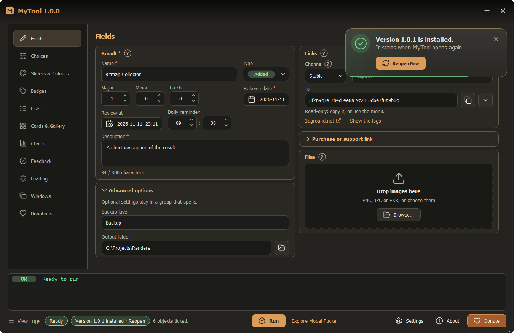

# Updates: self-update and Settings > Updates

How a tool made with this skill gets new versions, and what to do when the owner says "the tool needs updates".
Code: [updates template](templates/updates.md) (`updater.py`, `tools/release.py`), the launcher's `bootstrap.py`
([launcher-bootstrap](templates/launcher-bootstrap.md)), `Controller.check_updates`, the Settings group
([dialogs](templates/dialogs.md)) and `ToolWindow.on_update_result` ([tool window](templates/tool-window.md)). The
model is MaxPkg Packager 2.0's (verified download, one-step switch, rollback); MaxPkg Runtime Manager uses the same
rules with an immediate restart.

## Two ways a tool is updated

- **Through MaxPkg** (always): the tool is delivered as an MZP; publishing a new version on maxpkg.dev lets MaxPkg
  update the installed package (the copy next to the launcher). Nothing in the tool is needed for that.
- **Self-update** (optional, when the owner wants updates between MaxPkg releases or a check from inside the tool):
  the tool reads an `update.json` that the owner publishes, downloads the new version into the user profile
  (`%LOCALAPPDATA%\MyTool\app\v<version>`) and starts it at the next launch. The launcher always starts the **newest**
  copy: the installed update, or the copy next to the launcher when MaxPkg has put a newer one there since.

Turn self-update on by setting `UPDATE_URL` in `python/mytool/__init__.py`. With `UPDATE_URL = ""` there are no checks,
no network access and no Updates group in Settings.

## What the user sees

- **Settings > General > Updates** (only with an `UPDATE_URL`): a switch "Check for updates automatically and install
  them in the background" (on by default) and **Check Now** with a line that says the result: "You have the latest
  version (1.2.0).", "Version 1.3.0 is installed. It starts when MyTool opens again.", or why the check failed.
- **Automatic check**: 2 s after a normal start (not in safe mode), in a background job; failures stay quiet (only the
  log has them).
- **When a new version is installed**: a success toast "Version 1.3.0 is installed. / It starts when MyTool opens
  again." with **Reopen Now**, and a pill in the status bar "Version 1.3.0 installed · Reopen"; a click reopens the
  tool through its launcher (asking first while work runs). The running session is never changed.

## How it stays safe

1. `update.json` is read with a cache-busting query; offline or "not published yet" (404) is an expected outcome.
2. Only a newer version (`MAJOR.MINOR.PATCH` compared as numbers) is downloaded, to a `.part` file, with `curl.exe`
   as a fallback when Python cannot connect.
3. The archive must match the SHA-256 in `update.json`; it is unpacked into a staging folder with a path check
   (nothing outside the folder), its `bootstrap.py` and package must exist, the package version must equal the
   manifest's, and every `.py` file must compile (a syntax check; nothing is imported or run).
4. Only then the staging folder is renamed to `v<version>` and `current.json` is replaced in one atomic step. The
   previous version stays (two versions are kept); older ones are pruned.
5. The launcher's `bootstrap.py` starts the newest copy. If a freshly installed version fails to start, it rolls back
   once: to the previous installed version, or (with none) to the copy next to the launcher, and says so in the
   Listener. `bootstrap.py` itself is not updated by a self-update: keep it compatible with newer packages.

Never replace a published archive of a version with different bytes; publish a new version. Never update the running
session in place, never install without a checksum, never ask the user to delete folders by hand.

## When the owner asks for updates

1. Decide with the owner: MaxPkg only (publish a new version on maxpkg.dev), or self-update as well. For self-update
   choose where `update.json` and the archives are published (the raw files of the repository's main branch, for
   example `https://raw.githubusercontent.com/<owner>/<repo>/main/release/`, or a release's assets). Do not invent an
   address; ask for it.
2. Set `UPDATE_URL = "<base>update.json"` and raise `__version__`. Keep the MaxPkg package version the same number.
3. Run `python tools/release.py --base-url <base> --note "+ Added: ..."` (or write `release/notes.txt`). It writes
   `release/mytool-app-<version>.zip` (python/ and assets/, fixed timestamps) and `release/update.json`.
4. Publish the archive first and `update.json` last (an installed copy that reads the manifest must find its
   archive). Publishing, committing and pushing need the owner's explicit go-ahead.
5. Check an installed copy: Settings > Updates > Check Now shows the new version installed; Reopen starts it; Logs show
   "Update 1.3.0 installed" and "Starting MyTool 1.3.0".

## Tests (inside 3ds Max, no network)

Build two releases with the tool's own `tools/release.py` into a scratch folder with a `file:///` base URL, point
`UPDATE_URL` at it in the test and redirect the user data folder. Check: `check_updates` installs 1.0.1 and
`current.json` names the verified copy; the pill and the toast appear; `bootstrap.pick_root` starts the installed copy
when it is newer and the copy next to the launcher otherwise; a second update keeps the first as previous;
`bootstrap._roll_back` goes back to the previous version, and with none to the copy next to the launcher; a wrong
checksum installs nothing; Settings shows Updates only with an `UPDATE_URL`. Load `bootstrap.py`'s functions without
its last line (the call that starts the tool). Real network, a real publication and a real failed start stay separate,
explicitly reported tests.
