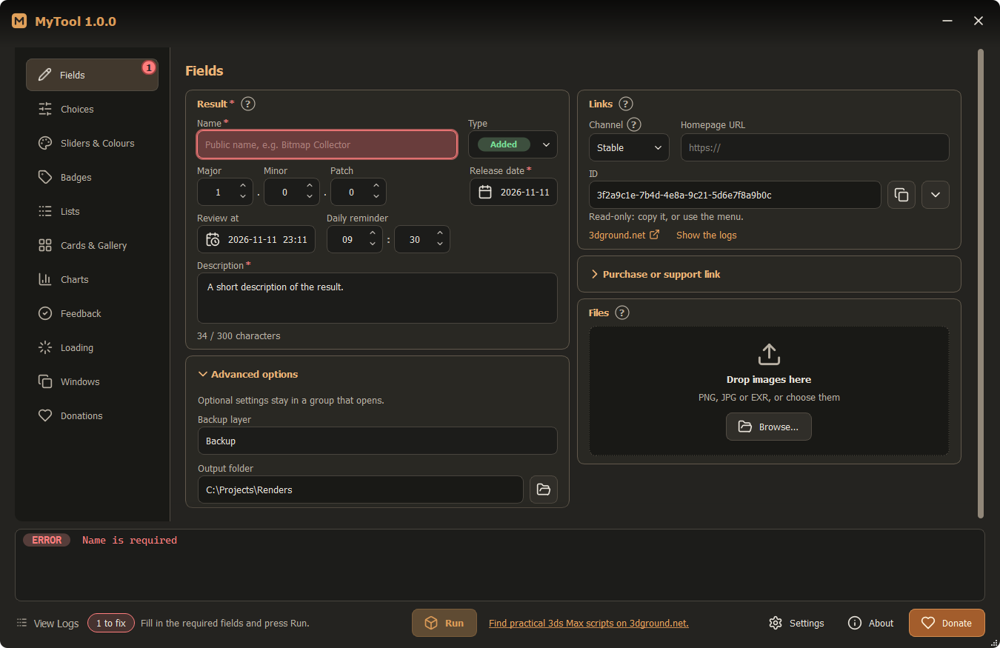
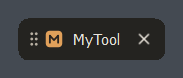
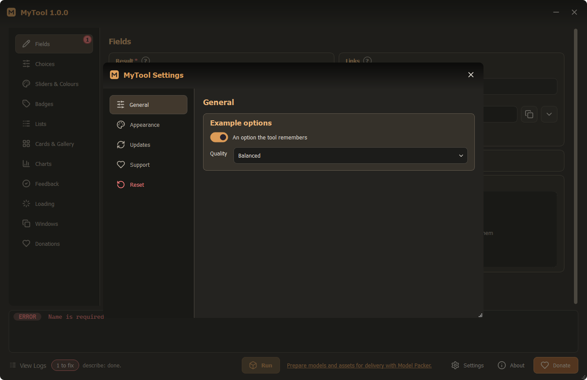

# Windows: title bar, edges, collapsed bar, dialogs

The standard window of a tool made with this skill. Implementation: [tool-window template](templates/tool-window.md).
All sizes are logical pixels at 100 % interface size; multiply them with `px()` ([interface size](interface-size.md)).

## Main window

- **Narrow by default.** One column about as wide as the Command Panel (300-360 px at 100 %), wider only when the
  content needs it; see the house rule in the [Qt design system](qt-design-system.md).
- **Frameless, own title bar.** `Qt.Window | Qt.FramelessWindowHint`, `WA_StyledBackground` (background from the style
  sheet), parented to `qtmax.GetQMaxMainWindow()` so it stays with Max and above it without always-on-top flags.
- **Title bar row** (margins 8 / 4 / 4 / 2, spacing 4): brand icon 18 px, 3 px gap, `Name version` (accent colour, bold,
  10 pt, object name `toolWindowTitle`), optional status pills right after the name, stretch, then two round window
  buttons (`controls.WindowButton`, 28 px circles, transparent at rest, a soft circle on hover): Lucide `minus`
  (collapse to the bar) and `x` (close). The close button turns red on hover (`#9f3636`, the same in every theme) with
  a white cross. Tooltips: "Collapse to a small bar (click its name to open again)", "Close Name".
- **Header shade.** A gradient from black at alpha 0.7 (`ToolWindow.HEADER_SHADE`) at the very top to transparent,
  painted on the window's own background behind the title bar and anything else that belongs to the header (a tab
  row). It ends exactly where the first panel starts: `header_bottom()` returns that y in window coordinates (below
  the title bar by default; a window with a tab row returns the bottom of its tabs plus the layout spacing). Not
  painted while collapsed.
- **Moving and maximising.** Dragging the title bar moves the window. Double-click toggles maximised. Dragging a
  maximised window restores it under the cursor at the same relative x.
- **Resizing.** A 4 px free margin around the content (`EDGE`); within `EDGE + 2` of an edge the cursor shows the
  matching resize arrow and a drag resizes, never below the minimum size. No resizing while collapsed or maximised.
  Children inherit the window's cursor and the window gets no event when the pointer moves from the edge onto a child,
  so entering the title bar, the content or the collapsed bar clears it: inside the window the pointer is the arrow.
  The window is resized only by the user: showing or hiding a part (the mini log, a group) takes room from the page.
- **Rounded corners.** Windows 11: `DwmSetWindowAttribute(hwnd, 33 /*DWMWA_WINDOW_CORNER_PREFERENCE*/, 2 /*ROUND*/)`
  plus `34 /*DWMWA_BORDER_COLOR*/` with the theme's `border` colour: smooth 8 px corners, a system shadow and a thin
  border. Where DWM refuses (Windows 10, some remote sessions), a rounded window mask of radius 8 (`setMask`, hard edges)
  on every resize. Maximised: no mask (square, as every Windows window). Safe mode: neither. Never use
  `WA_TranslucentBackground` for rounding inside Max (risky with Max's own windows).
- **Content** (margins 12 / 12 / 12 / 8, spacing 8): the tool's panels, then the status bar row.
- **Status bar row** (spacing 6): first on the left **View Logs** (`controls.StatusAction`: muted 11 px text after a
  12 px muted Lucide `logs` icon, no background or frame, hover changes only the text colour; it opens the Logs
  window), then status pill(s) and a muted one-line message that elides instead of widening the window (stretch), then
  ghost buttons with icon and text on the right: `Settings` (`settings`), `About` (`info`), and `Donate` (`heart`,
  variant `donate`) as the last button, only when the owner gave a donation destination. A window whose one main
  action belongs to the whole window (Run, Build) puts that primary button before Settings; while it works, the
  progress bar takes the message's place. In a narrow window Settings and About may be icon-only squares (tooltips and
  accessible names keep their words).
- **Update pill** (hidden until an update check finds something): "Version 1.3.0 available" or "Version 1.3.0
  installed · Reopen" after View Logs; a click reopens the tool through its launcher ([updates](updates.md)).
- **Toasts** (`ToolWindow.notify`) appear below the header at the right, over the content; see
  [controls catalog](controls-catalog.md#toasts).
- **Sizes.** Default about 900 x 600, minimum about 560 x 360 (scaled). The tool's own content decides the real values.
- **Place and size come back** on the next start (`saveGeometry` base64 in settings). A saved place that shows less than
  160 x 120 px on every screen is not restored: the window is centred on the work area of the screen under Max's main
  window, found by position. Safe mode ignores the saved geometry.
- **Closing ends the session** (`closeEvent` -> `controller.request_stop()`). While work runs, ask first with a
  question in the tool's own frame (`dialogs.ask`): "Work is running." with "Cancel It and Close" (red) and "Keep
  Working" (default). Hiding is not used.
- **Keyboard.** While any tool widget has focus, Max's hotkeys are off for it (`qtmax.DisableMaxAcceleratorsOnFocus` on
  the window and every child, again after widgets are created later), so Esc, Delete and letters reach the tool.

## Collapsed bar

The owner's standard way to collapse a tool: a small floating button over the viewport, as in MaxPkg Packager 2.0. The
minus button turns the same window into the bar: the title bar and the content are hidden, nothing is created or
destroyed. The bar's window is the bar's size hint plus the 4 px edge on every side (`2 * EDGE`), about 175 x 34 px at
100 % for a name like "MaxPkg Packager". `QFrame#toolMiniBar` is transparent: the bar shows the window's own
background, with the Windows 11 rounded corners and border from DWM, or the rounded mask where DWM is not available.

- **Contents, compact** (margins 2 / 1 / 1 / 1, spacing 2): a grip 14 x 22 with the 14 px Lucide `grip-vertical` icon
  in the muted colour (cursor: move), the brand icon 14 px, the tool's name only as a flat button (`text` colour, 9 pt,
  padding 2 / 6; the version is in its tooltip "Open Name version again"; click = open again), and the round close
  button at 22 px (`WindowButton(..., small=True)`, the `compact` property; red on hover). The bar is about 42 px high
  at 125 %. Dragging the grip or the name moves the bar; a click on the name without a drag (under 4 px) restores the
  window.
- **Where it appears.** If the user has never dragged it: 8 px inside the bottom-left corner of the **active viewport**
  (`viewport.getHWnd` + `GetWindowRect`, divided by the screen's device pixel ratio), on whichever monitor that
  viewport is. Outside Max or if the viewport cannot be read: bottom-left of Max's window, 110 px above its bottom.
  Once dragged, the place is saved (`mini_position`) and used from then on; a double-click on the grip forgets it and
  puts the bar back at the corner (`back_to_row`).
- **One row for every tool.** The collapsed bars of every tool built from this starter line up from the viewport
  corner to the right, 4 px apart, in the order they were collapsed. Nothing is shared but Qt properties on the bar
  windows (`ROW_PROPERTY = "maxToolCollapsedBar"`, `maxToolBarSince`, `maxToolBarPlaced`): each bar finds the others
  among the application's top-level windows (`row_slot`) and takes its own slot. A dragged bar leaves the row; when a
  bar opens again or is dragged away, the others close the gap. Keep the property names unchanged in every tool so
  their bars share the row.
- **Stays on the corner.** While collapsed, a light check every 500 ms (`watch_mini`; one Win32 call for the viewport
  rectangle and a look at the other bars, nothing else) moves an unplaced bar to its slot when the viewport layout,
  the active viewport, the Command Panel width or the monitor changes, which Max's window signals do not report. It
  runs only while collapsed and never during a drag.
- **Never under the taskbar or off the monitors.** Every drag goes through `bounded_window_position` (work area of the
  nearest screen, all four sides); the bar is confined again when a screen is added or removed or a work area changes.
- **Follows 3ds Max.** While collapsed, the bar listens to the `xChanged / yChanged / widthChanged / heightChanged`
  signals of Max's main `QWindow` (connected on collapse, disconnected on restore and close). It keeps
  its distance to Max's nearest edges, so maximising Max keeps it in its corner and moving Max to another display takes
  it along. 250 ms after the last move (one single-shot timer started by a move), an unplaced bar goes back to its
  slot at the active viewport's corner and a placed bar saves its new place. A bar the user put away from Max's window stays. While
  Max is minimised, Windows parks its window at (-32000, -32000): the bar ignores those positions.
  Ignore Max at x or y <= -30000 (Windows parks minimised windows at -32000; that move may come before the minimised
  state) and while minimised: Windows hides the bar with its owner and shows it again in place. Off in safe mode.
- **Restoring** brings back the exact place and size the window had (`saveGeometry` before collapsing). Ten collapse /
  restore rounds must leave the geometry unchanged.

## Dialogs

The veil lives and dies with its dialog: it goes when the dialog hides or is destroyed by any path. Nothing on it can
be clicked (a window-modal dialog blocks every input to its owner window), so it never carries buttons.

The main window and every resizable dialog show a size grip in the bottom-right corner, hidden while the window is
collapsed to the bar or maximised. About's hero is a gradient from the window colour (where the header shade ends) to
the recessed colour at the accent line, so the shade and the plate meet without a step.

- **Every window has the main window's chrome** (`dialogs.ToolDialog`): Settings, About, Logs, questions, small edit
  windows, an installer window. `Qt.Dialog | Qt.FramelessWindowHint`, parented to the main window; its own title bar
  (margins 12 / 8 / 8 / 6): the brand icon 18 px, the window's title in the main window's title style
  (`toolWindowTitle`, accent, bold) and the round close button (`WindowButton`, red on hover with a white cross).
  Dragging the title bar moves the window through `windowHandle().startSystemMove()` (Qt 5.15+, Windows snapping
  works), with a manual move as fallback. The same dark header shade as the main window (black at 0.7 alpha to
  transparent, ending 6 px below the title bar); Windows 11 rounds the corners (`round_window_corners`). Subclasses
  build into `self.content`. No native Windows title bar and no `QMessageBox` in a tool: questions are
  `dialogs.ask`.
- **Modality.** `WindowModal` for Settings, About and questions. The Logs window is **not modal** (`ToolDialog(...,
  modal=False, resizable=True)`): the tool stays usable and Live shows what it writes while the user works. A
  resizable window keeps a way to resize: a 16 px `QSizeGrip` in the bottom-right corner.
- **Buttons stay in view.** A dialog's buttons (Close, OK / Cancel, Donate) sit at the bottom outside any scroll area.
  Every dialog unifies its control heights when shown.
- **Veil.** While a modal tool dialog is visible, a child widget covers the owner window with the `recessed` colour at
  alpha 150 and follows its resizes; removed on hide. Only tool-owned windows are veiled; a modeless dialog veils
  nothing.
- **Theme.** Every dialog and every popup window (completer list, balloon, dropdown panel) registers with the theme
  manager: a separate window does not inherit the main window's style sheet or font.
- **One instance per dialog**, kept in `controller.dialogs`, raised when opened again, disposed on `finished`.
- **Popups** (help balloons, dropdown panels, completer lists) are frameless with a window mask for rounded corners and
  `Qt.NoDropShadowWindowHint`; a popup does not inherit its window's interface-size font, so set it from the parent.

## What this replaces in the general design system

The [Qt design system](qt-design-system.md) describes optional custom chrome in general terms. For tools made with this
skill, the frameless window, title bar, collapsed bar and status bar above are the standard; use native chrome only if
the user asks for it.
