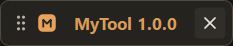
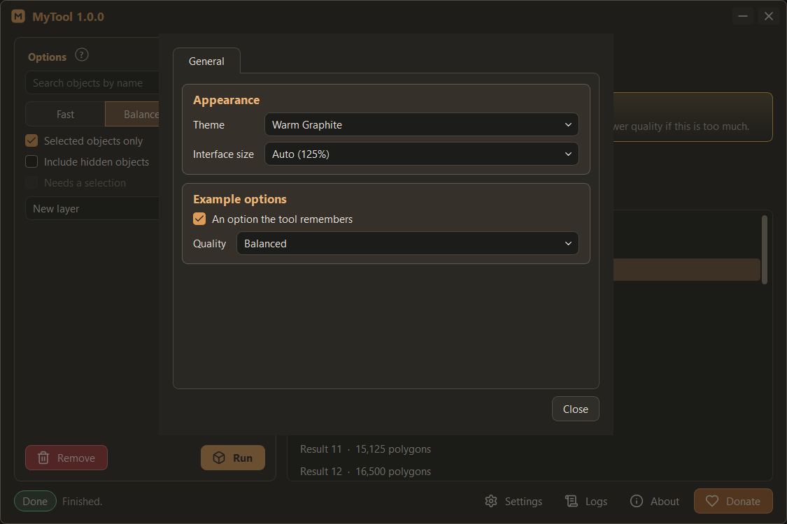

# Windows: title bar, edges, collapsed bar, dialogs

The standard window of a tool made with this skill. Implementation: [tool-window template](templates/tool-window.md).
All sizes are logical pixels at 100 % interface size; multiply them with `px()` ([interface size](interface-size.md)).

## Main window

- **Frameless, own title bar.** `Qt.Window | Qt.FramelessWindowHint`, `WA_StyledBackground` (background from the style
  sheet), parented to `qtmax.GetQMaxMainWindow()` so it stays with Max and above it without always-on-top flags.
- **Title bar row** (margins 8 / 4 / 4 / 2, spacing 4): brand icon 18 px, 3 px gap, `Name version` (accent colour, bold,
  10 pt, object name `toolWindowTitle`), optional status pills right after the name, stretch, then two square ghost
  icon buttons 26 x 26: Lucide `minus` (collapse to the bar) and `x` (close). Tooltips: "Collapse to a small bar (click
  its name to open again)", "Close Name".
- **Moving and maximising.** Dragging the title bar moves the window. Double-click toggles maximised. Dragging a
  maximised window restores it under the cursor at the same relative x.
- **Resizing.** A 4 px free margin around the content (`EDGE`); within `EDGE + 2` of an edge the cursor shows the
  matching resize arrow and a drag resizes, never below the minimum size. No resizing while collapsed or maximised.
- **Rounded corners.** Windows 11: `DwmSetWindowAttribute(hwnd, 33 /*DWMWA_WINDOW_CORNER_PREFERENCE*/, 2 /*ROUND*/)`
  plus `34 /*DWMWA_BORDER_COLOR*/` with the theme's `border` colour: smooth 8 px corners, a system shadow and a thin
  border. Where DWM refuses (Windows 10, some remote sessions), a rounded window mask of radius 8 (`setMask`, hard edges)
  on every resize. Maximised: no mask (square, as every Windows window). Safe mode: neither. Never use
  `WA_TranslucentBackground` for rounding inside Max (risky with Max's own windows).
- **Content** (margins 12 / 12 / 12 / 8, spacing 8): the tool's panels, then the status bar row.
- **Status bar row** (spacing 6): status pill(s) on the left, a muted one-line message (stretch), then ghost buttons with
  icon and text on the right: `Settings` (`settings`), `Logs` (`scroll-text`), `About` (`info`), and `Donate` (`heart`,
  variant `donate`) as the last button, only when the owner gave a donation destination.
- **Sizes.** Default about 900 x 600, minimum about 560 x 360 (scaled). The tool's own content decides the real values.
- **Place and size come back** on the next start (`saveGeometry` base64 in settings). A saved place that shows less than
  160 x 120 px on every screen is not restored: the window is centred on the work area of the screen under Max's main
  window, found by position. Safe mode ignores the saved geometry.
- **Closing ends the session** (`closeEvent` -> `controller.request_stop()`). While work runs, ask first: a warning box
  "Work is running." with "Cancel It and Close" (destructive) and "Keep Working" (default). Hiding is not used.
- **Keyboard.** While any tool widget has focus, Max's hotkeys are off for it (`qtmax.DisableMaxAcceleratorsOnFocus` on
  the window and every child, again after widgets are created later), so Esc, Delete and letters reach the tool.

## Collapsed bar

The minus button turns the same window into a small bar; nothing else is created or destroyed.

- **Contents** (margins 4 / 2 / 2 / 2, spacing 4): a grip 18 x 26 with the Lucide `grip-vertical` icon in the muted
  colour (cursor: move), the brand icon 16 px, the name `Name version` as a flat button (accent, bold, 10 pt; click =
  open again), and the `x` close button 26 x 26. Dragging the grip or the name moves the bar; a click on the name
  without a drag (under 4 px) restores the window.
- **Where it appears.** If the user has never dragged it: 8 px inside the bottom-left corner of the **active viewport**
  (`viewport.getHWnd` + `GetWindowRect`, divided by the screen's device pixel ratio). Outside Max or if the viewport
  cannot be read: bottom-left of Max's window, 110 px above its bottom. Once dragged, the place is saved
  (`mini_position`) and used from then on.
- **Never under the taskbar or off the monitors.** Every drag goes through `bounded_window_position` (work area of the
  nearest screen, all four sides); the bar is confined again when a screen is added or removed or a work area changes.
- **Follows 3ds Max.** While collapsed, the bar listens to the `xChanged / yChanged / widthChanged / heightChanged`
  signals of Max's main `QWindow` (connected on collapse, disconnected on restore and close; no polling timer). It keeps
  its distance to Max's nearest edges, so maximising Max keeps it in its corner and moving Max to another display takes
  it along. 250 ms after the last move (one single-shot timer started by a move), an unplaced bar goes back into the
  active viewport's corner and a placed bar saves its new place. A bar the user put away from Max's window stays.
  Ignore Max at x or y <= -30000 (Windows parks minimised windows at -32000; that move may come before the minimised
  state) and while minimised: Windows hides the bar with its owner and shows it again in place. Off in safe mode.
- **Restoring** brings back the exact place and size the window had (`saveGeometry` before collapsing). Ten collapse /
  restore rounds must leave the geometry unchanged.

## Dialogs

- **Native frame** for dialogs (Settings, Logs, About, confirmations): `QDialog`, `WindowModal`, parented to the main
  window. Set the flags explicitly: `Qt.Dialog | Qt.WindowTitleHint | Qt.WindowSystemMenuHint |
  Qt.WindowCloseButtonHint` (masking `windowFlags()` before the first show leaves a greyed-out close button, no "?").
- **Veil.** While a tool dialog is visible, a child widget covers the owner window with the `recessed` colour at alpha
  150 and follows its resizes; removed on hide. Only tool-owned windows are veiled.
- **Theme.** Every dialog and every popup window (completer list, balloon, dropdown panel) registers with the theme
  manager: a separate window does not inherit the main window's style sheet or font.
- **One instance per dialog**, kept in `controller.dialogs`, raised when opened again, disposed on `finished`.
- **Popups** (help balloons, dropdown panels, completer lists) are frameless with a window mask for rounded corners and
  `Qt.NoDropShadowWindowHint`; a popup does not inherit its window's interface-size font, so set it from the parent.

## What this replaces in the general design system

The [Qt design system](qt-design-system.md) describes optional custom chrome in general terms. For tools made with this
skill, the frameless window, title bar, collapsed bar and status bar above are the standard; use native chrome only if
the user asks for it.
